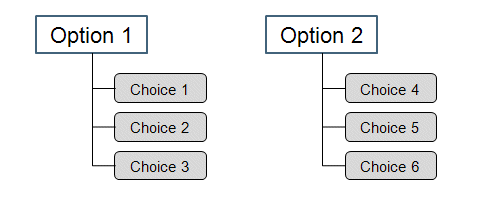

# Options and Choices

> 来源：PTC Windchill Help Center（R13.1.2.0）  
> 原文：[PTC Help Center](https://support.ptc.com/help/windchill/r13.1.2.0/en/Windchill_Help_Center/options/OptionRulesOview_2.html)  
> 获取日期：2026-11-12

Option choices are used in expressions that can be assigned to parts, occurrences, or usage links to specify whether a part should be included in a product variant. Each option describes a particular feature or facet of the product. An option has several choices that are applicable to specific variations of the product.

For example, an option country can have several choices: USA, Mexico, Japan. You can assign a condition to a part or part usage link as country = USA, Mexico. Later, when the Option Filter is applied to the product structure and country is set to USA or Mexico, the part is included in the product configuration as a result of filtering.

If the option set supports the use of exclude choices, you can also define conditions when the part is excluded from the product structure. For example, if the exclude assignment on the part is country != USA, this part is not included if USA is selected for the option country in the option filtering criteria.

## Required Option

When creating an option, you can specify whether that option is required. Required options cannot be skipped during the choice assignment or selection.

You can set the preference to check if the required options have been selected when specifying the option filtering criteria. From **Site**, choose Utilities > Preference Management, locate the Options and Variants section, and set the preference **Validate for Required Choices** to **Yes**. Once the preference is set, an error message appears if you attempt to exit the **Edit Filter** window without selecting a choice for any required option.

>  **Note:** The configure process always checks for required options regardless of how the **Validate for Required Choices** preference is set.

## Single Selection Option

An option can be defined as a single-selection option to allow only one choice to be selected from the choices that exist for this option. If an option is single-choice, selecting one of its choices during the choice assignment disables all other option choices.

The **Single Selection** column in the **Options** table (located under the **Design Option** or **Sales Option** tab in right pane of the **Option Pool** page) indicates whether an option is a single-choice option.
