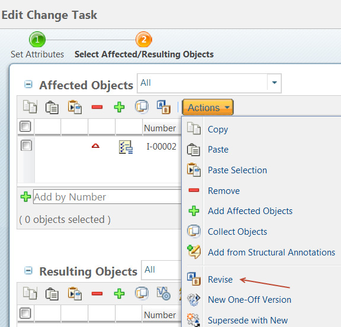

# Revision Control of Choice Rules

> 来源：PTC Windchill Help Center（R13.1.2.0）  
> 原文：[PTC Help Center](https://support.ptc.com/help/windchill/r13.1.2.0/en/Windchill_Help_Center/options/OptionsRevisionControlForRules.html)  
> 获取日期：2026-11-12

Choice rules are revision-controlled objects that can be revised based on the defined revision scheme and revision policies. The choice rule can be revised and released through the change process. The choice rules can also be configured to be automatically revised though the promotion workflow process.

>  **Note:** Ability to revise local rules is an advanced capability subject to a separate license entitlement.

## Revising Choice Rules

You can access the **Revise** action from the following locations:

- Go to the choice rules information page and select **Revise** from the **Actions** menu.

- Go to the Option Pool page. In the right pane, click the tab for the type of rules you want, right-click a rule in the rule table, and then select **Revise**.

- Go to the change task. Edit the affected object, and then select **Revise** from the **Actions** list on the **Affected Objects** table.

## Assigning Effectivity to Rule Revisions

Effectivity for choice rules can be planned and released through the change management process using a Change Notice.

You can also manually add an effectivity range for a selected revision of a choice rule. To do that:

1. Go to the information page of a choice rule.

2. Add the **Effectivity** tab by clicking a new tab and selecting Customize > General > Effectivity.

3. Click  and fill in the fields in the **Add Effectivity** window.

4. Click **OK**.

## Viewing the Revision History for Choice Rules

You can track the rule history from the **History** tab of the conditional rule information page. You can use the **Compare** action to compare multiple versions of choice rules to show the differences in description and lifecycle state.
