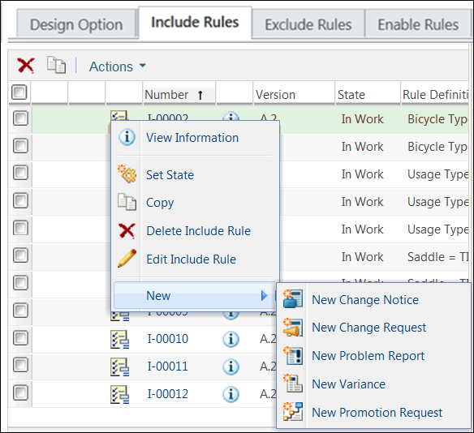

# Promotion Request for Choice Rules

> 来源：PTC Windchill Help Center（R13.1.2.0）  
> 原文：[PTC Help Center](https://support.ptc.com/help/windchill/r13.1.2.0/en/Windchill_Help_Center/options/OptionRulesPromotionRequest.html)  
> 获取日期：2026-11-12

All choice rules, including the company-defined subtypes, can be included in the maturity or promotion request processes similar to other Windchill objects. You can select choice rules as a seed object for the Promotion Request.

