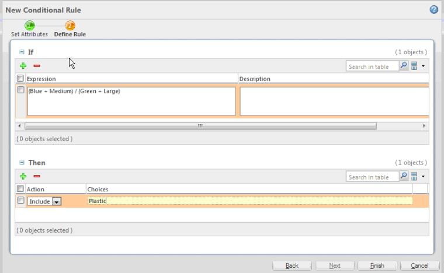
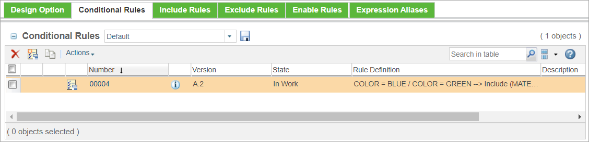
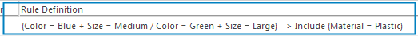
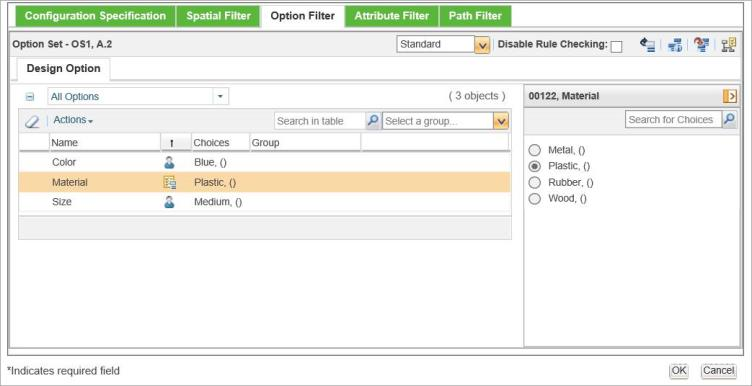

# Conditional Rules

> 来源：PTC Windchill Help Center（R13.1.2.0）  
> 原文：[PTC Help Center](https://support.ptc.com/help/windchill/r13.1.2.0/en/Windchill_Help_Center/options/OptionsConditionalRules.html)  
> 获取日期：2026-11-12

Conditional rules enable you to control the desired behavior during the choice selection process in the Option Filter. Conditional rules use the IF and THEN statements to specify when certain option choices should be included, disabled, enabled, or required based on the choice selections that the user specified in the Option Filter. For example, If Country = USA, then disable Color = Green.

>  **Note:** Ability to create and manage conditional rules is an advanced capability subject to a separate license entitlement.

Conditional rules consist of two parts – IF and THEN. The IF part describes the selections that trigger a certain action. The IF part contains one or more Boolean expressions that refer to option choices. Expressions are combined by an OR.

>  **Note:** Conditional rules can refer to option choices that belong to different option pools. This is different for include, exclude, and enable rules where choices must come from the same option pool.

The THEN part describes the action that should be applied to a set of choices when the IF expression is evaluated to TRUE. The possible actions are: Include, Disable, Enable, Requires, Requires Single Select.

The rules are evaluated when you specify the choice selection criteria in the **Option Filter** tab of the **Edit Filter** window.

The **New Conditional Rule** window (see the next figure) is used to enter the IF and THEN statements and the action, for example,

If (Blue + Medium) / (Green + Large), then Include Plastic

You can create conditional rules within an option pool (global rules) or within an option set (local rules). You can create, edit, and delete conditional rules from the **Conditional Rules** tab from the Option Pool or the Option Set page (see the next figure). Once created, you can see conditional rules in the **Conditional Rules** table.

The **Conditional Rules** table in the figure below shows the rule created using the following IF and THEN statements with the Include action:

If (Blue) / (Green), then Include Plastic

The effect of conditional rules is observed during the option filtering process. For example, for a conditional rule describing the following logic:

Selecting Color = Blue and Size = Medium causes Material = Plastic to be selected automatically (see the next figure).

## Syntax for Creating Conditional Rules

Consider these guidelines for entering conditional rules:

- A conditional rule can have multiple expressions in the IF part. Each row in the **If** section of the window represents an expression. The OR operator is implied between the rows of expressions.

- For example, consider the following two expressions entered in the IF section:

- (Canada && French)

- (Switzerland && German)

- The two expressions are combined as the following IF statement:

\[Country = Canada + Language = French\] OR \[Country = Switzerland + Language = German\]

- The conditional rule can have multiple THEN statements.

- For example, for the above IF statement, the action Include = Red, Medium entered in the first row and the action Enable = Fast entered in the second row of the **Then** section, creates the following conditional rule with multiple THEN statements:

\[Country = Canada + Language = French\] OR \[Country = Switzerland + Language = German\] --> Include (Color = Red, Size = Medium) Enable (Speed = Fast)

For information on the accepted operators used for creating expressions, see [Defining Options with Advanced Expressions](https://support.ptc.com/help/windchill/r13.1.2.0/en/Windchill_Help_Center/sim_installconfig/sis10109.html).

## Validating Expressions

In addition to the standard validation performed by the system, companies can implement a custom validation. For more information, see [Validating Expressions](../../../05-assigning-expressions/12-validating-expressions/index.md#wwID0ENEBS "Validating Expressions").
