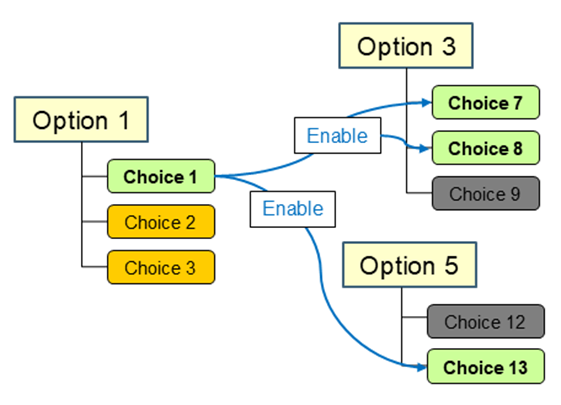
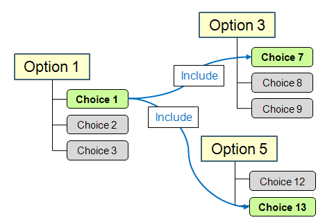
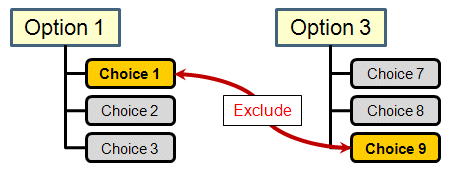
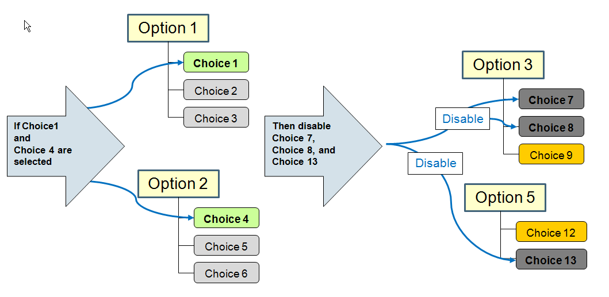

# Defining Global Rules for Options and Choices

> 来源：PTC Windchill Help Center（R13.1.2.0）  
> 原文：[PTC Help Center](https://support.ptc.com/help/windchill/r13.1.2.0/en/Windchill_Help_Center/options/OptionsGlobalRules.html)  
> 获取日期：2026-11-12

To assist the user in selecting valid choices when configuring the product structure, the Option Manager can define the rules that regulate which combinations of choices can be allowed for the assignment on a part and part usage in the product structure. These rules also govern the selection of choices for filtering the product structure using the Option Filter.

Rules can be defined within an option pool and within an option set. The rules created in the option pool are referred to as **global rules**. The rules created in the option set are referred to as **local rules**.

You can create the following rules to establish relationships among option choices:

- Enable rule — Specifies which choices become available for selection once the source choice is selected. For example, as shown in the diagram below, selecting Choice 1 (Option 1) makes Choice 7 (Option 3), Choice 8 (Option 3), and Choice 13 (Option 5) available for selection. At the same time, Choice 9 and Choice 12 become disabled.

- Include rule – Identifies the target choices that are selected automatically once the source choice is selected. For example, as shown in the diagram below, selecting the source Choice 1 of Option 1 automatically selects the target choices – Choice 7 of Options 3 and Choice 13 of Option 5.

- Exclude rule – Specifies an invalid combination of choices. For example, as shown in the diagram below, selecting Choice 1 of Option 1 disallows the selection of Choice 9 of Option 3, and the other way around.

- Conditional rule – Uses the IF and THEN statements to specify when certain option choices should be included, enabled, or disabled based on the choice selections that the user specified in the Option Filter.

