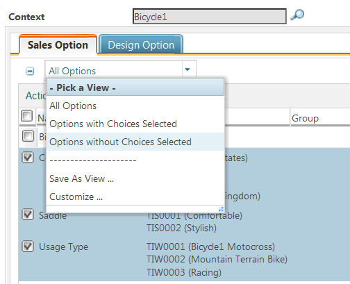
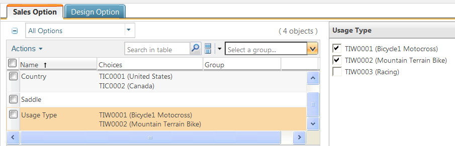

# Managing Choices in the Option Set

> 来源：PTC Windchill Help Center（R13.1.2.0）  
> 原文：[PTC Help Center](https://support.ptc.com/help/windchill/r13.1.2.0/en/Windchill_Help_Center/options/OptionsAddToSet.html)  
> 获取日期：2026-11-12

Once you created an option set, you can add choices to it.

To add choices:

1. Go to the information page of the option set and click the **Structure** tab.

2. Click the toolbar action . The **Manage Choices** window opens.

3. By default, the **Context** field shows the current context. You can add choices from the options defined in another context by searching for and selecting that context.

4. Select the tab for the type of options to select from: design or sales.

5. The table lists the options from the option pool of the selected context. For each option, the associated choices appear in the **Choices** column. You can filter the table by selecting **Options with Choices Selected** and **Options without Choices Selected** from the pull-down list at the top of the table. Alternatively, you can view all options available.

6. Select the choices to add to the option set. As you select an option, the right panel opens to allow you to select the desired choices. You can select all or only some choices from that option.

|  |  |
| --- | --- |
| **** | To select all choices, click the checkbox at the top of the option list. |

|  |  |
| --- | --- |
| **** | The **Manage Choices** window does not display the merged choices that were added from a lower-level option set. If you wish to modify those choices, you need to remove them from the merged option set. For more information on removing the merged choices, see [Removing Merged Choices and Rules](../../../05-merging-option-sets/03-removing-merg-b3cafce6/index.md#wwID0E2EVR "Removing Merged Choices and Rules"). |

7. After adding choices of one type of options, you can select the tab for another type.

8. After you selected all choices, click **Apply** to add the selected choices to the option set.

9. When finished, click **OK** to return to the information page of the option set.

After you have added the choices to the option set, you can:

- Review the choices you have added by clicking **Sales Option** or **Design Option** tab.

- Review and manage rules by clicking the corresponding tab: **Enable Rules**, **Include Rules**, **Exclude Rules**, or **Conditional Rules** tab.

- Check for duplicate choices by clicking .

- Preview the option set by clicking .
