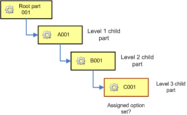

# How Windchill Determines the Assigned Option Set To Use

> 来源：PTC Windchill Help Center（R13.1.2.0）  
> 原文：[PTC Help Center](https://support.ptc.com/help/windchill/r13.1.2.0/en/Windchill_Help_Center/options/OptionAssignOptionSetToPart.html)  
> 获取日期：2026-11-12

An option set can be assigned directly on a configurable product or part, or it can be inherited from a root configurable product or its context. Assigning an option set to a configurable module allows you to use a different option set for a specific technology or a functional unit. For steps on assigning an option set to a configurable module, go to [Assigning an Option Set to an Object](../index.md#wwID0EVWRR "Assigning an Option Set to an Object").

## Rules for Determining Which Assigned Option Set to Use

When determining which option set to use for assigning choices on part usages as well as for specifying filtering criteria, the system looks for the assigned option set in the following order:

1. Checks if the configurable module has the assigned option set.

2. If not found, checks if the configurable module’s context has the assigned option set.

3. If not found, checks if the root configurable module has the assigned option set.

4. If not found, checks if the root configurable module’s context has the assigned option set.

When determining which option set to use for assigning item choices on parts, the system looks for the assigned option set in the following order:

1. Checks if the configurable module has the assigned option set.

2. If not found, checks if the configurable module’s context has the assigned option set.

## Example of How the Assigned Option Set is Inherited by a Configurable Module

This example illustrates the logic for determining the assigned option set for a configurable module in a structure. For example, a part structure, with the root part 001, includes 3 levels of child parts. Suppose the system needs to determine the assigned option set for the level 3 child part, C001.

When the system determines the assigned option set for part C001, it checks if the part B001 has the assigned option set, and then if it is not found, checks if the part’s B001 context has the assigned option set. Then, if it is not found, the system checks the root part 001 if it has the assigned option set, and finally checks the root part’s context for the assigned option set.
