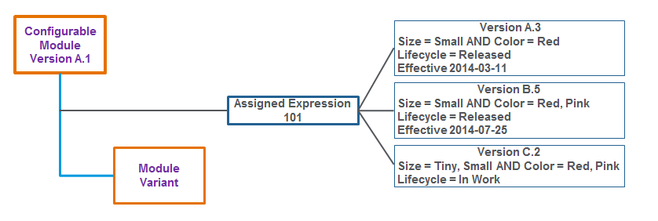
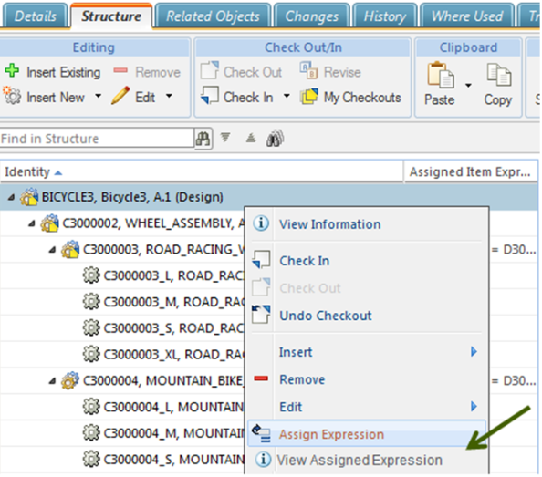
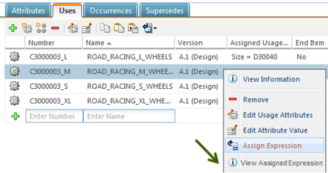

# Independent Assigned Expressions

> 来源：PTC Windchill Help Center（R13.1.2.0）  
> 原文：[PTC Help Center](https://support.ptc.com/help/windchill/r13.1.2.0/en/Windchill_Help_Center/options/OptionsIndepExpressions.html)  
> 获取日期：2026-11-12

>  **Note:** Ability to create and manage independent assigned expressions is an advanced capability subject to a separate license entitlement.

Companies can configure assigned expressions to be iterated and revised independently from the object they are assigned to. Such expressions are referred to as independent expressions. Creating or editing an independent assigned expression does not change the iteration of the configurable module to which it is assigned. Similarly, when you modify a configurable module, the independent assigned expression associated with that module is not iterated.

Independent expressions can be assigned to parts, part usage links, and occurrences.

>  **Note:** When you revise a part to which an independent expression is assigned, the part maintains the reference to the master of the independent expression object. When you create a copy of the part with using Save As, the copy uses the latest checked in version of the independent expression.

To create independent expressions, you use the same user interface as for assigning dependent expressions. You can get information about the change history, effectivity, and where used information from the information page of the independent expression.

To assign independent expressions, you need proper access control:

- Create and edit access for the Independent Assigned Expression object in the default domain

- Modify access to the system cabinet

Consider this information about independent expressions:

- You can submit independent expressions to change and promotion processes.

- Independents expressions have their own lifecycle states and effectivity.

- A configuration specification determines the version of the assigned independent expressions to be used for filtering a configurable structure.

- Assigning an independent expression to a part (or any of its usage links and occurrences) does not require the part to be checked out.

- Replacing a child part that has an independent expression assigned to its usage links preserves that assigned expression.

- When filtering a configurable product structure, you can set the configuration specification for the Option filter to determine the version of the independent expressions to evaluate and compare with the filtering criteria.

- When creating a copy of the part, independent expressions are also copied.

## Enabling Independent Expressions

To enable independent expressions, a site administrator must run the command-line utility:

windchill com.ptc.windchill.option.tools.ConvertToIndependentExpression

After this utility is run, all new expressions are created as independent expressions.

## Assigning and Editing Independent Expressions

When creating independent expressions, you can enter the name of the expression. Other steps for creating and editing independent expressions are the same as for dependent expressions.

>  **Note:** Administrators can make the Name attribute a required attribute by modifying constraints for the Name attribute of the Independent Assigned Expression objects using the **Type and Attribute Management** utility.

## Viewing Independent Expressions

To view the information page for the independent expressions assigned to parts and part usage links, go to the part **Structure** tab, right-click a configurable module, and select **View Assigned Expression**. The system opens the information page of the latest iteration of the latest revision of the independent expression that is assigned to the item or usage link.

>  **Note:** This action is also available from the folder browser page and from the search results page.

From the **Actions** menu on the information page, you can set the state, copy, edit, or revise the independent expression.

## Revising Independent Expression

Independent expressions can be revised as other Windchill objects. The **Revise** action is available from the **Actions** menu on the expression information page, and from the **Affected Object** table on the change task.

## Deleting Independent Expressions

Use **Delete** from the information page of an independent expression to delete the latest revision of the expression, including all of it iterations within the selected revision (for example, C.1, C.2, C.3). When you delete a revision, previous revisions remain intact. For example, if you delete the C revision, the expression goes back to the latest iteration of the previous revision (for example, B.3).

This action is available only if the expression has more than one revision. At least one version of the independent expression must remain if it is referenced by an item, a usage link, or an occurrence. The expression can only be deleted completely if the object that references it is deleted.

>  **Note:** The **Delete** action is available only to the Option Managers who are members of the Platform Structures license group.
