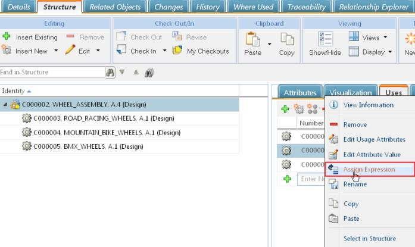

# Assigning Expressions to Usage Links of Configurable Modules

> 来源：PTC Windchill Help Center（R13.1.2.0）  
> 原文：[PTC Help Center](https://support.ptc.com/help/windchill/r13.1.2.0/en/Windchill_Help_Center/options/OptionsAssignChoices.html)  
> 获取日期：2026-11-12

You can assign expressions to usage links of configurable modules. Consider this information for assigning expressions:

- An option set must be assigned to the part or its context, or to the root part or its context. The context is a product or library to which this part belongs.

- The selected part is a child of a configurable module.

- You can assign basic or advanced expressions, if advanced expressions are supported for your site and product.

You can assign expressions from the **Uses** tab on the **Structure** tab of the information page of a configurable module.

To assign expressions to part usages:

1. Go to the **Structure** tab of a part information page.

2. Go to the **Uses** tab.

3. Right-click a child of a configurable module and select **Assign Expression**. The user interface for assigning expressions opens.

1. The **Assign Basic Expression** window is used to assign basic expressions. For steps for defining basic expressions, go to [Defining Basic Expressions](../07-defining-basic-ac2838/index.md#wwID0EF23R "Defining Basic Expressions").

1. The **Assign Advanced Expression** window is used to assign advanced expressions. For steps for defining advanced expressions, go to [Defining Advanced Expressions](../08-defining-adva-d6095590/index.md#wwID0EVO4R "Defining Advanced Expressions").

|  |  |
| --- | --- |
| **** | If the toggle  action is available, you can toggle the window between the basic expressions and the advanced expressions. The  icon appears if the current assignment type disagrees with the setting of the Supported Expressions preference setting, or if the preference is set to both types. |

4. When finished, click **OK**.

|  |  |
| --- | --- |
| **** | You can configure the tables to add the **Assigned Usage Expressions** column. |
