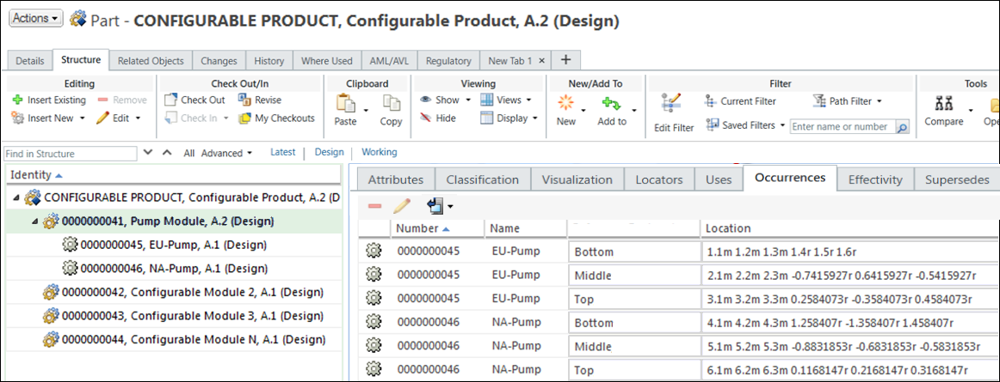
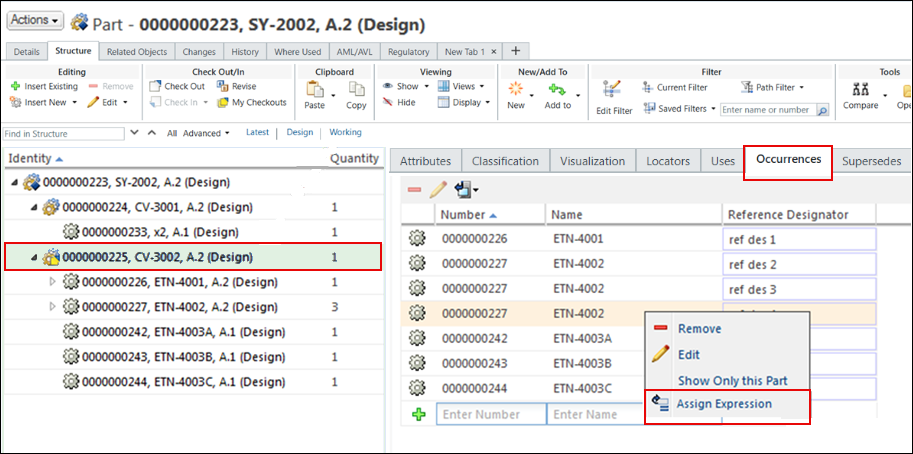

# Assigning Expressions to Uses Occurrences

> 来源：PTC Windchill Help Center（R13.1.2.0）  
> 原文：[PTC Help Center](https://support.ptc.com/help/windchill/r13.1.2.0/en/Windchill_Help_Center/options/OptionAssignExpressToOccurrences.html)  
> 获取日期：2026-11-12

Part occurrences can be used to control the positioning of certain parts in the product assembly. For example, for one product variant, a pump module must be located at the top of the assembly, while for another product variant the pump module must be located at the bottom of the assembly. An overloaded product structure can contain multiple occurrences of the part that can be included in the variant if certain conditions are met. If an expression is assigned to an occurrence, the Option filter evaluates it based on the specified filtering criteria, and as result includes or excludes the part.

You can assign basic and advanced expressions to uses occurrences. You can assign an expression to an occurrence only if the parent part has the assigned option set and the part usage has a unit value of “each”.

When a CAD structure is generated from the part structure, information on the expressions assigned to part occurrences is transferred to the associated CAD structures.

The next figure shows an occurrence table with assigned expressions.

Expressions assigned to occurrences are iterated and can be revised and behave similar to expressions assigned to usage links.

## Assigning Basic or Advanced Expressions to Part Occurrences

To assign expressions to occurrences, the following must be true:

- The parent part is a configurable part.

- The user is a member of the Platform Structures license group.

- The parent part has an option set assigned.

To assign an expression to an occurrence:

1. Go to the **Structure** tab of a configurable module.

2. In the tree structure, click a configurable module whose occurrences you want to view.

3. Click the **Occurrences** tab in the right pane.

4. In the **Occurrences** table, right-click an occurrence of a part usage with the unit value of “each” to which you want to assign an expression, and then click **Assign Expression**.

5. Assign an expression as you would for usage links and parts.

You can add the **Assigned Occurrence Expressions**, **Assigned Usage Expressions**, and **Assigned Item Expressions** columns to the table by managing the table views to view the assigned expressions in the **Occurrences** table.
