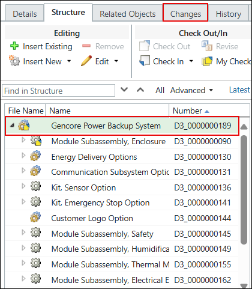

# How the System Determines the Assigned Option Set When Assigning Expressions

> 来源：PTC Windchill Help Center（R13.1.2.0）  
> 原文：[PTC Help Center](https://support.ptc.com/help/windchill/r13.1.2.0/en/Windchill_Help_Center/options/OptionsAssignedOptionSetDetermine.html)  
> 获取日期：2026-11-12

To determine which option set to use when assigning expressions directly on a configurable module or part:

- The system uses the option set assigned directly to the given configurable module.

- If there is no option set assigned directly to the configurable module, the system uses the option asset assigned to the product or library container to which this configurable module belongs.

To determine which option set to use when assigning expressions to a usage link of a configurable module:

- The system uses the option set assigned directly to the parent configurable module for the given usage link.

- If there is no option set assigned directly to that parent configurable module, the system uses the option set assigned to the product or library container to which the parent configurable module belongs.

- If there is no option set assigned to the container for the parent configurable module, the system uses the option set assigned directly to the root configurable module in the product structure tree.

|  |  |
| --- | --- |
| **** | The next figure shows what is considered a root configurable module in the product structure. |

- If there is no option set assigned directly to the root configurable module in the product structure tree, the system uses the option set assigned to the product or library container to which this configurable module belongs.
