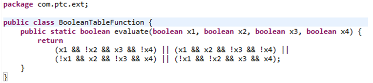
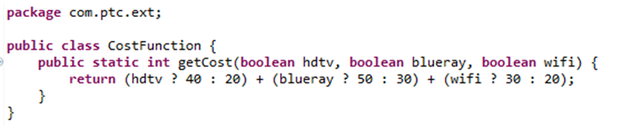

# Using Functions in Advanced Expressions

> 来源：PTC Windchill Help Center（R13.1.2.0）  
> 原文：[PTC Help Center](https://support.ptc.com/help/windchill/r13.1.2.0/en/Windchill_Help_Center/options/OptionsUsingFunctInExpressions.html)  
> 获取日期：2026-11-12

This topic explains different ways of defining functions used in expressions assigned to usage links and parts, and evaluated during the Option filtering process by the Option filtering delegate. The next sections cover the following aspects:

- Different ways to specify an alias for a function to reduce the size and enable reuse of expressions

- Information on how the implementor of the functions can get access to the objects of the filtering framework: the Option navigation filter, navigation criteria, option set, effectivity date, objects being filtered or involved in the filtering process (such as parts, usage links, and data associated with them).

## Overview of the Function Definition and Its Use in Expressions

Define a Java class with a public static method (a function) taking arguments that you want to pass to the function. The only variable arguments that you can pass to the functions are Choices (specifically, their selection status true if selected, and false if not selected) and the object of type com.ptc.windchill.option.model.ATONavigationBean provided and populated by the filtering framework at runtime (described in a later section). Once defined, the public static method of the Java class can be used in the expression in a number of different ways using the following formats:

- Using the full class path to the method

- Using the ClassName.MethodName() format if the corresponding import for the class is defined

- Using the MethodName() format () if the corresponding static import for the class is defined

- Using the MethodAbbreviation() if the abbreviation (or alias) is defined for the method

- Using the macro if the macro is defined

In the following sections, you can find examples of constructing some sample functions and expressions with these functions for each of the afore-mentioned situations. You can write functions to take advantage of the variable ATONavigationBean object that provides access to the current NavigationCriteria, ATONavigationFilter, effectivity date of the Option filter, the option set of the Option filter, choices selected in the Option filter, the selection status for all choices in the OptionSet, the current NavigationUnit with the Filterable node (for example, WTPartUsageLink) and supporting nodes (for example, child WTPart of the usage link). In particular, this allows the use of other objects (such as attribute values on parts, usage links, and usage occurrences) in the filtering decisions.

## Function Definition

To define a function, write a Java class with a public static method with the desired arguments.

Java Code:

Explanation:

This is an example of a static Boolean function that takes four Boolean arguments and returns a value as determined from the following truth table (T means true, F means FALSE):

Truth Table:

| x1 | x2 | x3 | x4 | Return |
| --- | --- | --- | --- | --- |
| T | F | T | F | T |
| T | T | F | F | T |
| F | T | F | T | T |
| F | F | T | T | T |

All other combinations of x1, x2, x3, and x4 produce the FALSE value (F).

To arrive at the corresponding expression for each row, substitute the name of the parameter for T (for example, x1), the negation of the parameter for F (! x1), and concatenate these results with conjunction operators (&&). For example, the first row results in the following expression:

x1 && ! x2 && x3 && ! x4

Then, you concatenate row Boolean expressions with the disjunction operators (||) to arrive at the expression representing the truth table.

>  **Note:** If you use the same choice repeatedly in the expression, you can benefit from introducing a function and using it in the expression, as explained next.

The function can return any type (for example, any of the number primitive such as int, double, float) and then can be compared with the constant of the same type to produce a Boolean expression as in the following example.

These kinds of functions allow you to filter out those configurations that exceed the total cost specified. Another approach is to pass the cost integer as another parameter to the function, and do comparison inside the function itself. This results in returning a Boolean from the function.

## Use in Expressions

In the following examples, it is assumed that we have choices RED, GREEN, BLUE, WHITE from the COLOR option; UK, US, MX from the COUNTRY option; PLASTIC, STEEL, WOOD from the MATERIAL option; and SMALL, MEDIUM, LARGE, X\_LARGE from the SIZE option. We also use choices hasHD\_TV, hasBLUERAY, hasWI\_FI.

## Using the Full Class Path to the Method

In this case, you use the full class path plus the method name to specify the function. As arguments to the function in this example, you pass choice names. The following examples illustrate this approach:

- com.ptc.ext.BooleanTableFunction.evaluate(RED, UK, PLASTIC, LARGE)

- BLUE && com.ptc.ext.BooleanTableFunction.evaluate(GREEN, US, STEEL, SMALL) || MEDIUM

- com.ptc.ext.CostFunction.getCost(hasHD\_TV, hasBLUERAY, hasWI\_FI)> 100

## Using the Import Declarations

The classes to be imported can be specified in the properties file WT\_HOME/codebase/ com/ptc/wpcfg/exparser/LookUpService.properties as follows:

- exparser.import.1=com.ptc.ext.BooleanTableFunction

- exparser.import.2=com.ptc.ext.CostFunction

In this case you can omit the package path when specifying the function in the expression:

- BooleanTableFunction.evaluate(RED, UK, PLASTIC, LARGE)

- BLUE && BooleanTableFunction.evaluate(GREEN, US, STEEL, SMALL) || MEDIUM

- CostFunction.getCost(hasHD\_TV, hasBLUERAY, hasWI\_FI)> 100

## Using Static Import Declarations

In this case, you first specify the static import declarations in the properties file WT\_HOME/codebase/ com/ptc/wpcfg/exparser/LookUpService.properties as follows:

exparser.static.import.1=com.ptc.ext.BooleanTableFunction

exparser.static.import.2=com.ptc.ext.CostFunction

In this case, you can omit both the package path and the class name (leaving only the method name) when specifying the function in the expression:

- evaluate(RED, UK, PLASTIC, LARGE)

- BLUE && evaluate(GREEN, US, STEEL, SMALL) || MEDIUM

- getCost(hasHD\_TV, hasBLUERAY, hasWI\_FI) > 100

## Using Abbreviations (aliases) for Methods

In this case, you define the mapping between an abbreviation for a method and the full path to the method in the properties file WT\_HOME/codebase/ com/ptc/wpcfg/exparser/LookUpService.properties as follows:

exparser.abbreviation.1=EVAL=com.ptc.ext.BooleanTableFunction.evaluate

exparser.abbreviation.2=COST=com.ptc.ext.CostFunction.getCost

Then, you can use these aliases to access the function in expression:

- EVAL(RED, UK, PLASTIC, LARGE)

- BLUE && EVAL(GREEN, US, STEEL, SMALL) || MEDIUM

- COST(hasHD\_TV, hasBLUERAY, hasWI\_FI) > 100

## Using Macros

Unlike the abbreviations that provide aliases for the full function path of a single function, a macro is an alias for an expression fragment. It is useful when an expression fragment is used repeatedly on numerous objects such as usage links and parts. Import, static import, and abbreviation declaration are resolved on-the-fly during the expression parsing. Macro fragments are first substituted for macros in the expression, and then the expression is parsed. As other parser properties, macro mappings are defined in the WT\_HOME/codebase/com/ptc/wpcfg/exparser/LookUpService.properties as follows:

exparser.macro.1=EVALUATE=com.ptc.ext.BooleanTableFunction.evaluate(GREEN, US, STEEL, SMALL)

exparser.macro.2=GET\_COST= com.ptc.ext.CostFunction.getCost(hasHD\_TV, hasBLUERAY, hasWI\_FI)

Then, the last two expressions assume the form:

- BLUE && EVALUATE || MEDIUM

- GET\_COST > 100

The macros are useful to denote the ATONavigationBean that contains information about navigation criteria and the structural objects being filtered.

## Accessing Current Filtering Information

The object com.ptc.windchill.option.model.ATONavigationBean is a wrapper bean over instances of the ATONavigationFilter and the current NavigationUnit provided by the filtering framework. Apart from the filter and the navigation unit, the bean defines the methods for obtaining the NavigationCriteria, effectivity date of the Option filter, the OptionSet, the choices selected in the Option filter and the selection status for all choices in the OptionSet grouped by the option.

public ATONavigationFilter getFilter();

public NavigationUnit getNavigationUnit();

public NavigationCriteria getNavigationCriteria();

public Timestamp getFilterEffectivityDate();

public OptionSet getFilterOptionSet();

public Map<String, Set<String>> getFilterChoiceMap();

public Map<String, Boolean> getFilterSelectedChoiceMap();

## Using ATONavigationBean in Expressions

To use the bean, you must first define a function that takes it as one of its parameters. As an example, built-in class is available to you – com.ptc.windchill.option.filter.NavigationUtils that provides methods (functions) for comparing the filter effectivity dates with the fixed upper and/or lower timestamp bounds.

public static boolean afterDate(ATONavigationBean beanOfActivity, String after)

public static boolean beforeDate(ATONavigationBean beanOfActivity, String before)

public static boolean betweenDate(ATONavigationBean beanOfActivity, String after, String before)

There are three other methods that take an additional String argument to specify the date pattern (useful for non-American locales). When specifying the concrete object in the expression, you need to pass an empty object of type ATONavigationBean as returned by the static method ATONavigationBean.newATONavigationBean(). It is convenient to use a macro for denoting the bean provided by this fragment. The filtering framework populates the bean with the ATONavigationFilter and the NavigationUnit, giving you access to the current filtering data.

First of all, define a macro for an instance of the ATONavigationBean and abbreviations for the methods of NavigationUtils in the file LookUpService.properties as follows:

exparser.macro.1=EFFECTIVITY\_INFO= com.ptc.windchill.option.model.ATONavigationBean.newATONavigationBean()

exparser.abbreviation.1=BEFORE= com.ptc.windchill.option.filter.NavigationUtils.beforeDate

exparser.abbreviation.2=AFTER= com.ptc.windchill.option.filter.NavigationUtils.afterDate

exparser.abbreviation.3=BETWEEN= com.ptc.windchill.option.filter.NavigationUtils.betweenDates

Now you can define an expression that depends on which time interval the effectivity date falls in:

RED && SMALL && BEFORE(EFFECTIVITY\_INFO, “05/05/2005”) ||

GREEN && LARGE && BETWEEN(EFFECTIVITY\_INFO, “05/05/2005”, “06/06/2006”) ||

BLUE && MEDIUM && BETWEEN(EFFECTIVITY\_INFO, “06/06/2006”, “07/07/2007”) ||

WHITE && X\_LARGE && AFTER(EFFECTIVITY\_INFO, “07/07/2007”)

This expression effectively takes on four different forms, as specified in each row, based on the four different disjoint time intervals:

RED && SMALL - if effectivity date is before **05/05/2005**

GREEN && LARGE - if effectivity date is between **05/05/2005** and **06/06/2006**

BLUE && MEDIUM - if effectivity date is between **06/06/2006** and **07/07/2007**

WHITE && X\_LARGE - if effectivity date is after **07/07/2007**
