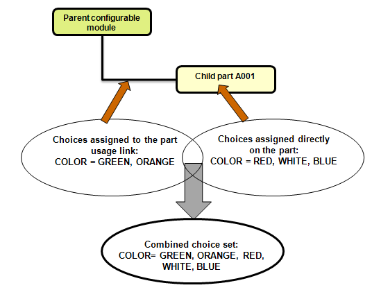
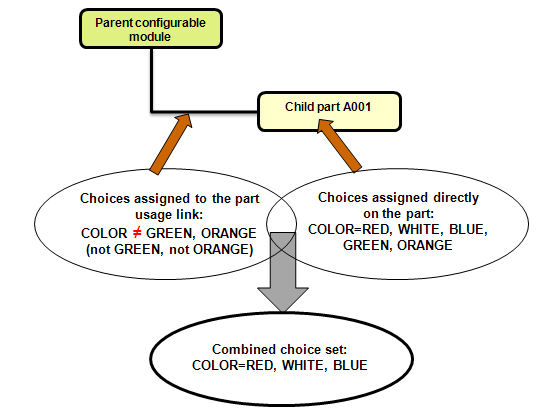

# Frequently Asked Questions About Expressions Assignment and Filtering

> 来源：PTC Windchill Help Center（R13.1.2.0）  
> 原文：[PTC Help Center](https://support.ptc.com/help/windchill/r13.1.2.0/en/Windchill_Help_Center/options/OptionsFAQ.html)  
> 获取日期：2026-11-12

## What is a use case for exclude choices?

You can use **exclude choices** that are assigned on the part’s usage link to specify the conditions when a part should be excluded rather than included in a product structure. For example, if a part’s usage link is assigned an exclude choice Country≠USA, selecting Country = USA in the Option filter results in the part being excluded from the product structure.

The following use case illustrates when an assignment of exclude choices can be useful. For example, a product is sold in USA and Canada. Suppose, a module of this product is a water pump, and one variant of the water pump (WP1) cannot be used in the USA. The design team may assign the choice Country = Canada to the variant part WP1. To exclude WP1 in the USA product variant, the usage link of WP1 can be assigned an exclude choice Country ≠ USA.

Suppose, it is later decided that the product will be also sold in Brazil. The water pump variant part WP1 must be then updated to include Country = Canada, Brazil. Because USA is excluded using an exclude choice on the usage link, the addition of other countries at a later time requires no maintenance of the water pump variant part WP1. Filtering the product structure using Country = USA excludes WP1. Filtering the product structure using Country = Canada selects WP1 for inclusion.

## Can exclude choices be assigned on a part?

No. Exclude choices can only be assigned on a part’s usage link. All choices for a given option must be either exclude choices or include choices.

## How does the Option filter evaluate assignments when basic expressions are assigned on both the part and its usage link?

There is no order of precedence when the system evaluates the basic expressions assigned on the part and the choices assigned on the usage link of that part. All assigned choices are combined for the purpose of matching them with the Option filter selections. This scenario applies to include choices only (that is, when the option set has **Allow Assignment of Exclude Choices** set to **No**).

## How can I override basic expression assignments for a particular usage of the part?

If basic expressions are assigned directly on the part, every usage of the part carries that assignment. To restrict the assignment for a particular usage of the part in the part structure, follow this technique:

>  **Note:** Make sure the assigned option set supports assignment of exclude choices on the usage links (that is, the option set has **Allow Assignment of Exclude Choices** set to **Yes**).

1. Assign expressions directly on the part. These expressions should cover all possible conditions when the part is included in the product structure.

2. Assign **exclude choices** to the usage link of the part. These choices capture exceptions for this particular usage of the part, and they are a subset of the choices assigned on the part directly.

3. When applying the Option filter, the system subtracts the exclude choices assigned on the usage links from the choices assigned directly on the part. The resulting subset is used to determine whether the part is included or excluded.

For example, suppose that the part is assigned choices RED, WHITE, BLUE, GREEN, ORANGE, and the part appears in 100 products. Suppose, in one of the products the GREEN and ORANGE variations are not supported by this part.

In this case, you need to assign exclude choices GREEN, ORANGE to the usage link of the part for that product. Notice that the Assigned Choices column for this part’s usage shows COLOR != GREEN, COLOR != ORANGE (or COLOR != GREEN, ORANGE). This means that when GREEN or ORANGE is selected in the Option filter, the part should not be included in the product structure.

When the Option filter is applied to the product structure, the system uses the choices on the part (RED, WHITE, BLUE, GREEN, ORANGE) and subtracts the choices on the usage link (GREEN, ORANGE) because they are excluded. The resulting set (RED, WHITE, BLUE) is matched against the choices selected in the Option filter. If you specify RED, WHITE, or BLUE in the Option filter, this usage of the part is included in the product structure. If you specify GREEN or ORANGE in the Option filter, this usage of the part is not included in that product structure.

