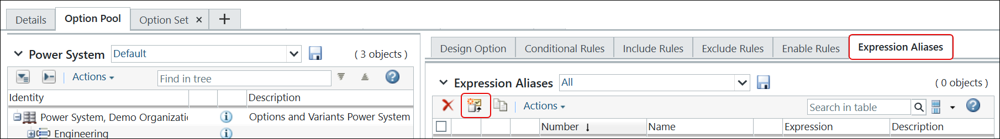

# Viewing Aliases

> 来源：PTC Windchill Help Center（R13.1.2.0）  
> 原文：[PTC Help Center](https://support.ptc.com/help/windchill/r13.1.2.0/en/Windchill_Help_Center/options/OptionsViewingAliases.html)  
> 获取日期：2026-11-12

To view aliases defined within the option pool:

1. Go to the **Option Pool** tab of the product or library.

2. Click the top-level node in the option pool tree.

3. Click the **Expression Aliases** tab. The **Expression Aliases** table lists the existing aliases. From this table, you can delete, copy, or edit aliases. You can also revise an alias, or add an alias to a change request or change notice.

