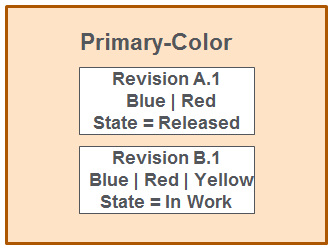

# Managing Alias Objects

> 来源：PTC Windchill Help Center（R13.1.2.0）  
> 原文：[PTC Help Center](https://support.ptc.com/help/windchill/r13.1.2.0/en/Windchill_Help_Center/options/OptionsManagingAliasObjects.html)  
> 获取日期：2026-11-12

Aliases are primary business objects:

- Aliases are lifecycle-managed objects.

- They can be iterated and revised.

- You can view the history of aliases.

- Aliases follow the change processes as other Windchill objects.

- You can set up access control policies for aliases.

- Aliases are promotable objects.

- You can assign date effectivity to aliases (set automatically by the change workflow or directly by the user).

Whenever you update an alias, the system iterates it. An alias can be revised to capture different definitions of the alias. For example, the A.1 definition of the alias PrimaryColor can be Blue or Red, while the B.1 revision of that alias can have a definition of Blue or Red or Yellow.

You can use configuration criteria to determine the revision of the assigned expressions and aliases to use (based on the lifecycle and date effectivity) when filtering the product structure.

## Defining Alias Subtypes

Administrators can define additional subtypes for the alias object using the **Type and Attribute Management** utility.
