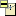

# Specifying the Filtering Criteria for the Option Filter

> 来源：PTC Windchill Help Center（R13.1.2.0）  
> 原文：[PTC Help Center](https://support.ptc.com/help/windchill/r13.1.2.0/en/Windchill_Help_Center/options/OptionsFilteringSpecify.html)  
> 获取日期：2026-11-12

To specify filtering criteria and to apply them to the product structure:

1. Go to the **Structure** page for the top-level part of the structure that you want to filter.

2. Click **Edit Filter** from the toolbar.

3. In the **Edit Filter** window, click the **Option Filter** tab.

|  |  |
| --- | --- |
| **** | The assigned option set is listed at the top of the window under the filter tabs. |

|  |  |
| --- | --- |
| **** | • Groups, options, and choices in the **Option Filter** window are displayed by default in the same order as defined by Option Manager. • Different sorting can be applied to the options and choices. To return to the default display order set by the Option Manager, use the **Sort by Default Order** table column action. This action is available only on the last user-defined sorting column of the table for an option set. For more information about this action, see [Managing the Option Set](../../03-working-with-op-fa126a/02-workflow-for-82e49141/05-managing-the-op-3c36f1/index.md#wwID0EZ3JR "Managing the Option Set"). |

4. Before you start selecting choices, the actions located in the top-right corner of the window can be used:

- Disable rule checking by selecting **Disable Rule Checking**.

|  |  |
| --- | --- |
| **** | The **Disable Rule Checking** action disables system checks for choice rules, choice date effectivity, and for the Minimum Required and Maximum Allowed child parts. This allows a filtered configurable structure that may not comply with the choice rules and the constraint on the number of the child parts. This action also changes the currently selected choices to the user selected status. Enabling the rule checking restores the selected choices to the set selected at the initial display and enables system checks for choice rules, choice date effectivity, and for the Minimum Required and Maximum Allowed child parts.. |

- Override the current version of the assigned option set by clicking  to select the latest version of a specific revision.

- View the assigned option set by clicking  provides information on the Option Set.

- Set the Option Filter configuration specification by clicking . For more information, see [Specifying the Configuration Specification for the Option Filter](01-specifying-th-49668ccf/index.md#wwID0E6MHS "Specifying the Configuration Specification for the Option Filter").

5. Select the **Design Option** tab.

|  |  |
| --- | --- |
| **** | Depending upon the type of option defined, options are displayed in different tabs. By default, the **Design Option** tab is displayed. For more information, see [Enabling or Disabling Sales and Design Subtypes](../../02-creating-and-ecce0b1d/04-enabling-or-d-bf274673/index.md#wwID0EPHSQ "Enabling or Disabling Sales and Design Subtypes"), [Creating a New Option Subtype](../../02-creating-and-ecce0b1d/05-creating-a-ne-91df4e4c/index.md#wwID0ENUSQ "Creating a New Option Subtype"), and [Customizing the Display Name of the Option Type](../../02-creating-and-ecce0b1d/06-customizing-t-2e39a40f/index.md#wwID0ERDTQ "Customizing the Display Name of the Option Type"). |

6. The **Design Option** tab lists the options included in the option set. Previously selected choices are listed in the **Choices** column. Specify the filtering criteria by selecting the appropriate choices:

1. Click an option, and all choices defined for this option appear in the right pane of the window.

1. In the right pane, click the choices that you want to include in the filtering criteria. The selected choice and any rule driven selected choices are added to the left pane of the window. The **Selection Status** column can be used to identify user selected choices and rule driven selected choices.

|  |  |
| --- | --- |
| **** | You can locate a specific option or choice by using the **Search in table** feature. For more information about this feature, see [Searching within Tables](https://support.ptc.com/help/windchill/r13.1.2.0/en/Windchill_Help_Center/search/LclSrchSearchInTables.html). |

|  |  |
| --- | --- |
| **** | You can filter the table by selecting **Options with Choices Selected** and **Options without Choices Selected** from the pull-down list at the top of the table. Alternatively, you can view all options available. |

7. When finished, click **OK**. When you close the **Edit Filter** window, the filtering criteria are applied to the product structure and the page is refreshed.

Rules affect which choices are selectable, and what choices are selected automatically. For more information, see [Effect of Rules on Choice Selection](../05-effect-of-rul-e22ab0c4/index.md#wwID0E11IS "Effect of Rules on Choice Selection").

## Overriding the Version of the Option Set

The assigned option set is a version-controlled object; therefore, when an option set is assigned, it is the specific version of the option that is assigned. If you want to try out a different version of the assigned option set when defining filtering criteria, you can temporarily override the currently assigned option set by selecting another version. This override does not affect other users of the option set.

>  **Note:** The ability to override is available to Product Managers, Options Managers, and product members.

To override the option set version, click  and select another version from the **Override Option Set Revision** window. To remove the override, click the **Undo Option Set Override**  icon. This restores the assigned option set version.

## Viewing and Selecting Boolean Choices using Textual Entry for Option Filter

In the **Option Filter** tab, click the  **Display Selected Choices** icon to view a summary of the choices selected in the current Option Filter. This switches the display of the options table to the **Selected Choices** table. The “No” choices are displayed with the negation character that you specified in the ato.negation.operator property in the wt.properties file. To perform any management actions on choices, expand the right-hand panel available In the **Display Selected Choices** view, which is collapsed by default.

You can select and add choices to the Option Filter definition by using the textual entry field that becomes available within the choice panel. You can specify a boolean option by name or number based on the **Choice Display Format** preference by selecting the appropriate value from the **Rule and Expression Format** drop-down menu. For boolean options, both the boolean option choices, Yes and No, are automatically selected together for Option Filter evaluation. To add the choices to the **Selected Choices** table, click **Add**.

To remove one or more choices from the **Selected Choices** table, right-click a choice and select **Remove**. This action is also available in the table toolbar. However, you cannot use this action to remove a choice that is included by a rule.

## Viewing the User Selected and Rule Driven Choices

When rule checking is enabled, user selection of a choice can drive the selection of one or more choices based on the system evaluation of the defined rules. User of the Option Filter can use the **Selection Status** column to better understand whether a choice was manually selected by a user or automatically selected by a rule. This status provides information about the choices that are directly selected by the user and the choices, selection of which is driven by rules.

## Using Saved Filter or Variant Specification Option Filter

A previously saved filter or variant specification applies the saved selected choices without applying the current option set definitions or rule definitions. To update a saved filter or variant specification, it must be edited using the corresponding action.

## Editing Saved Filter or Variant Specification Option Filter

When editing a saved filter or a variant specification where rules or option set definitions have changed, the previously selected choices can change due to the administrative changes. Depending on these administrative changes, the following scenarios can take place:

- Rule driven selected choices may change based upon the same user selected choices.

- User selected choices may become rule driven selected choices as a result of the choices selected earlier in the saved order.

- As a result of the choices selected earlier in the saved order, the previously selected choices may no longer be considered a valid combination, as defined by the rules.

The **Selection Status** column displays the following statuses of the choices:

- **User Selected**

- **Rule Driven**

The preference **Selection Status Display Format** available under the **Options and Variants** node controls the display of the choices in the **Selected Choices** table. You can set this preference to any of the following values:

- **User selected only**: Selecting this value displays only the choices that are selected by user.

- **Rule driven only**: Selecting this value displays choices that are driven by rules.

- **Both**: Selecting this value displays both, choices that are selected by user and choices that are driven by rules.

The default value is **User selected only**.
