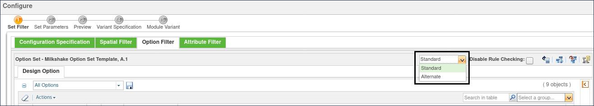

# Standard and Alternate Option Filter

> 来源：PTC Windchill Help Center（R13.1.2.0）  
> 原文：[PTC Help Center](https://support.ptc.com/help/windchill/r13.1.2.0/en/Windchill_Help_Center/options/OptionsStandardAlternateOptionFilter.html)  
> 获取日期：2026-11-12

>  **Note:** Ability to set the filtering model is an advanced capability subject to a separate license entitlement.

When filtering a configurable product structure with assigned expressions, companies can choose one of the following filtering methods provided out-of-the-box:

- Standard filter – (Default) Shows all configurable modules, unless the assigned expression evaluates as FALSE. If the expression is undefined, the expression is evaluated as TRUE.

- Alternate filter – Filters out all configurable modules, unless the assigned expression evaluates as TRUE. If the expression is undefined, the expression is evaluated as FALSE.

For example, you may have an option COLOR with choices Red, Green, Blue, and have assigned a basic expression “Red/Blue” to a usage link of a module variant.

- If you select Red in the Option Filter, the expression evaluates to TRUE.

- If you select Green in the Option Filter, the expression evaluates to FALSE.

- If you make no selections for the option COLOR, the expression evaluates to Undefined.

Out-of-the-box, the standard and alternate filtering methods differ in the way they treat expressions that evaluate to Undefined. If the assigned expression has a choice that belongs to an option for which the user did not make any choice selection in the Option Filter, then the assigned expression is undefined.

Evaluation of an assigned expression uses the short-circuit method:

- If TRUE OR X => TRUE (If the expression uses the OR operator, and at least one selection matches the assignment, the whole expression is evaluated as TRUE.)

- If FALSE AND X => FALSE (If the expression uses the AND operator, and at least one selection does not match the assignment, the whole expression is evaluated as FALSE.)

where X represents TRUE, FALSE, or Undefined.

## An Example of Using Standard and Alternate Filter

Consider an option set with the following options and choices:

- Color

- Red

- Blue

- Green

- Size

- Small

- Medium

- Large

Suppose that a part has an assigned expression: Blue AND Medium

Consider the following scenarios:

- If you select Blue and Medium in the Option Filter, the assigned expression evaluates to TRUE.

- Using the Standard filter - the part is not filtered.

- Using the Alternate filter - the part is not filtered.

- If you select Red and/or Small in the Option Filter, the assigned expression evaluates to FALSE.

- Using the Standard filter - the part is filtered.

- Using the Alternate filter - the part is filtered.

- If you select a Color=Blue and make no selection for the Size, or you select Size=Medium and make no selection for the color, the assigned expression cannot be evaluated and is considered undefined.

- Using the Standard filter - the part is not filtered.

- Using the Alternate filter - the part is filtered.

## Selecting the Filtering Method

To select the filtering method, select **Standard** or **Alternate** from the toolbar dropdown list in the following locations:

- The **Option Filter** tab in the **Edit Filter** window.

- The **Preview** window for previewing the option set.

- The **Set Filter** step of the **Configure** window.

