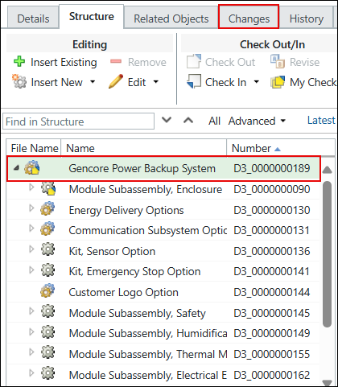

# Filtering a Configurable Product Structure with the Option Filter

> 来源：PTC Windchill Help Center（R13.1.2.0）  
> 原文：[PTC Help Center](https://support.ptc.com/help/windchill/r13.1.2.0/en/Windchill_Help_Center/options/OptionsProductStructureNav.html)  
> 获取日期：2026-11-12

After expressions have been assigned to parts and part usage links in an overloaded product structure, you can apply the Option Filter to the part structure to include or exclude parts based on their assigned expressions. After the filtering criteria are applied, the resulting product structure represents a specific configuration of that product. When a part is filtered from the product structure, all children of that part are also excluded. To learn about the steps involved in the filtering process, see [Overview of the List-based Option Selection and Filtering](https://support.ptc.com/help/windchill/r13.1.2.0/en/Windchill_Help_Center/ccm_oview/OptionsApplyingOptionsFilter.html).

By applying the Option Filter, you can:

- Test and validate the selection logic

- Although some companies use a sales configurator to create desired product configurations, filtering enables engineers to validate and troubleshoot the logic in Windchill before it is used in the configurator.

- Preview the resulting product structure

- You can display viewables for the resulting product structure to show only the components that are included in the filtered structure.

- Send a filtered structure to a package

- You can share a specific configuration of the product with your business partner. To do this, you can create a package that contains a filtered product structure, and share this package in a project.

## How the System Determines the Assigned Option Set for the Option Filter

The Option Filter is available only if the assigned option set is available. The options and choices that appear in the Option Filter come from the assigned option set.

This is how the system determines which option set to use for the Option Filter:

- The system uses the option set assigned directly to the root configurable module in the product structure tree.

- If there is no option set assigned directly to the root configurable module in the product structure tree, the system uses the option set assigned to the product or library container to which the root configurable module belongs.

>  **Note:** The next figure shows what is considered a root configurable module in the product structure.
