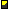

# Set Parameters Step: Providing Inputs for Part Parameters

> 来源：PTC Windchill Help Center（R13.1.2.0）  
> 原文：[PTC Help Center](https://support.ptc.com/help/windchill/r13.1.2.0/en/Windchill_Help_Center/options/OptionsCapturingInputs.html)  
> 获取日期：2026-11-12

In this step, you provide input values for the parameters that govern the customizable aspects of the variant part.

If the part has an advanced selection logic defined, the advanced selection logic definition determines not only the parameters displayed but also many aspects of what is displayed. These include, but are not limited to, the following:

- Number of pages displayed for collecting input parameter values

- Inclusion of an optional page image

- Order of parameters

- Input required or optional

- Single or multiple selection

- Default value for input parameters

- Optional parameter value image

For more information on advanced selection logic definitions, see [Developing Advanced Selection Logic for Configurable Modules](../../../../03-developing-ad-954fbdfc/index.md).

To provide inputs for the parameters defined by the advanced selection logic:

1. If the part has an advanced selection logic defined, you are presented with a number of input pages from which you can select values for the specified parameters. The parameters appear in a specific order in the input pages.

2. Provide single or multiple values for each parameter as appropriate for the parameter type and input definition. You can open the left pane of the input page to view how the product structure is updated based on your selections.

3. Make selections for the parameters displayed and click **Next** to go to the next page.

4. After you have made all your selections on this page, you can save them and continue with the configuration process. To save the settings, click the **Save** button. If the variant specification has not yet been created, you are placed in the Variant Specification step, allowing you to specify the name of the variant specification. To return to where you were in the configuration process, click **Continue**.

5. After you have finished defining the parameter values, you can review your inputs.

6. The **Review Inputs** table displays each parameter with its selected value. Additionally, the **Notes** column displays the value of the CalculationExplanation property if it has been defined for the parameter. To change any of your input values, click .

7. Click **Next** to view the possible variant solutions. The left pane shows the product structure of a proposed variant solution. The Variant Solution table in the right pane describes the configuration selections for this solution. If more than one solution is available, select the desired solution where the last solution is the default selection. Once you have selected the desired solution, click **Next** to move to the next step of the configuration process.

## Checking for the Minimum and Maximum Number Child Parts in a Variant Solution

If you accepted a solution in which the number of child parts of the configurable module violates the Minimum/Maximum constraint, a window appears, listing the configurable modules that have this violation, including the navigation path to the parts in the structure.

You can either return to the step where you can redefine your inputs and correct the violation or save the incomplete variant specification and redefine it later. If a violation is not corrected, you cannot generate a variant, and the configuration process ends at the Variant Specification step. For more information on how to set the Minimum/Maximum number of child part for the configurable module, see [Restricting the Number of Child Parts](../../../04-setting-up-co-f8cb7439/05-restricting-t-8740c98d/index.md#wwID0EBYWR "Restricting the Number of Child Parts").

If you save the variant specification that contains a violation, its information page shows a glyph , indicating an incomplete variant specification. The **Request Deliverables** action is not available for an incomplete variant specification.

>  **Note:** If you select **Disable Rule Checking** when using the **Option Filter** tab (during the Set Filter step of the part configuration process), the system skips the verification step for the Minimum Required and Maximum Allowed child parts, allowing you to create a variant part that violates the constraints on the number of the child parts.However, if there is no option set assigned to the product to which the part belongs, the **Option Filter** tab is not available in the Set Filter step, and therefore you cannot disable this check. In such cases, if the Minimum Required and Maximum Allowed constraints are set, the system performs the check for the number of child parts.
