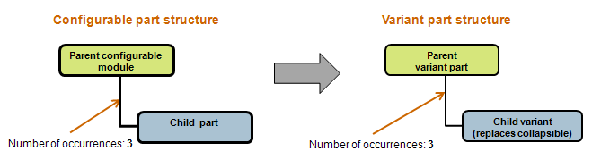
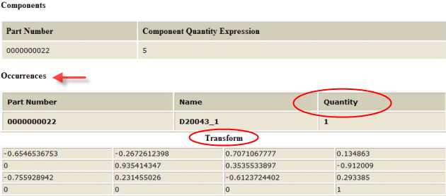
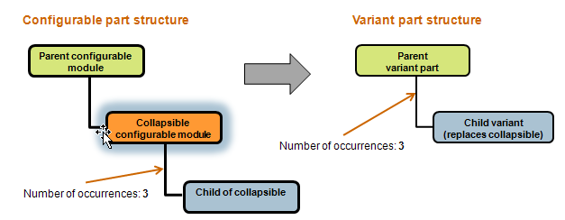
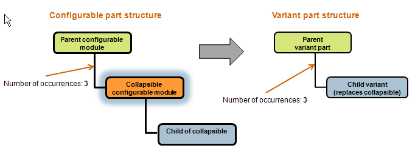
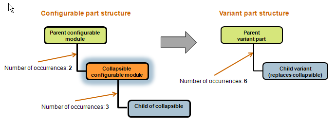

# Capturing Transformation Matrices and Part Occurrences in the Variant Part Structure

> 来源：PTC Windchill Help Center（R13.1.2.0）  
> 原文：[PTC Help Center](https://support.ptc.com/help/windchill/r13.1.2.0/en/Windchill_Help_Center/options/OptionsVariantOccurr.html)  
> 获取日期：2026-11-12

When a variant part structure is created from a configurable part structure, it inherits information about occurrences and positioning of child parts. Positioning of each occurrence of a child part within a configurable CAD assembly is described by a transformation matrix. The next diagram illustrates how the number of occurrences of a child part from a configurable structure get copied into the variant structure.

You can view information on each occurrence, including its positioning, in the View Logic report that is available for the parent configurable part. To access the View Logic report, go to the information page of the configurable part and click Actions > View Logic. The next figure shows an excerpt from the View Logic report, showing information on an occurrence: its name, quantity, and transformation matrix.

## Determining the Number of Occurrences and Positioning of Child Parts of a Collapsible Configurable Module

A configurable structure may contain a collapsible configurable module, which is replaced by a child part in the resulting variant structure. In such cases, the number of occurrences on the usage of the variant child part takes into account the number of occurrences on the usage of its collapsed parent. The diagrams below illustrate several cases of how occurrences are calculated for the resulting variant.

In this example, there are 3 occurrences of the child part of the collapsible configurable module. Therefore, these occurrences will be copied in the variant structure by copying the occurrence name, quantity, and transformation matrix.

In this example, there are 3 occurrences of the collapsible configurable module. Therefore, these occurrences will be copied in the variant structure by copying the occurrence name, quantity, and transformation matrix.

In this example, the number of occurrences in the variant is determined based on the number of possible combinations of the parent-to-collapsible and collapsible-to-child occurrences. The quantity of the occurrences in the variant structure is calculated by multiplying the quantities between the parent and child. The transformation matrix for each occurrence is calculated by multiplying the transformation matrices of the given combination of the parent/child occurrences.

