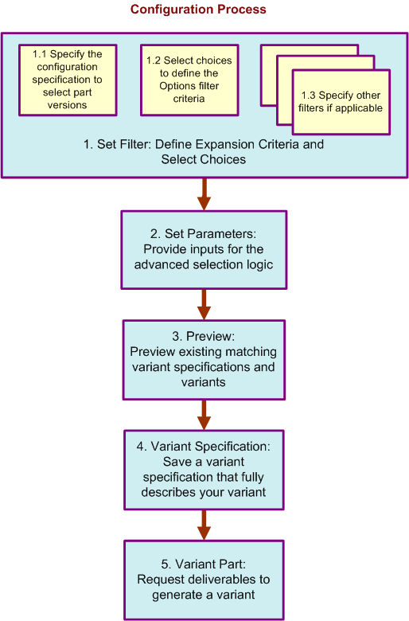

# Creating Variant Structures Using the Configure Process

> 来源：PTC Windchill Help Center（R13.1.2.0）  
> 原文：[PTC Help Center](https://support.ptc.com/help/windchill/r13.1.2.0/en/Windchill_Help_Center/options/OptionsCongfigureProcess.html)  
> 获取日期：2026-11-12

The Configure process for configurable modules is a multistep process that allows you to define variable aspects of the configurable module structure by using the selection logic and part structure filters that are relevant to this configurable module. For example, you may want to first select part versions by defining a configuration specification, and then apply a filter to select parts based on the choices (assigned to parts or their usage).

The definitions and inputs that you provided are captured in a variant specification. Before saving a variant specification, the configuration process allows you to reuse any of the existing matching variant specifications to avoid creating duplicate objects. Finally, at the end of the process, you can generate a deliverable—a variant part structure, or you can request a deliverable later from a saved variant specification.

The next figure outlines the main steps of the part configuration process.

To start the configuration process, right-click the configurable part and select **Configure**. The **Configure** window opens, guiding you through the configuration steps. Some of the configuration steps are optional, and you can skip them, making only those selections that are relevant to your configuration process.

|  |  |
| --- | --- |
| **** | The **Configure** action is also available from the **Actions** menu of a configurable part information page in the Product and Library contexts. |

|  |  |
| --- | --- |
| **** | It is recommended that you do not use Refresh (F5) during the configure and reconfigure process, as this can produce a processing error. |

>  **Note:** If you are not using advanced selection logic, then PTC recommends setting the ato.configuration.mode property. This greatly improves performance in step 2 of the **Configure** action.1. Open a windchill shell.2. Run the following command: xconfmanager –s ato.configuration.mode=true –t codebase/wt.properties –p
