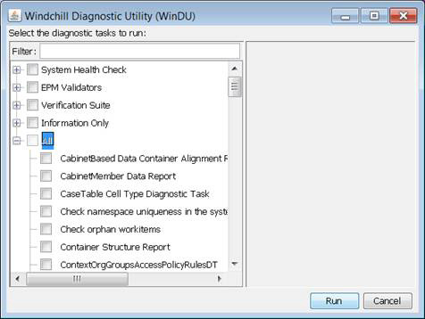
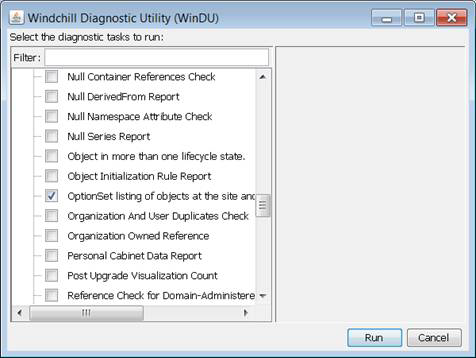
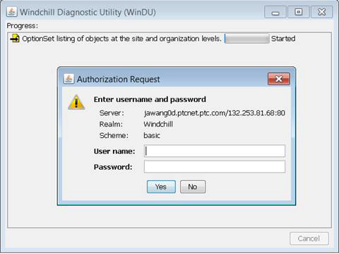
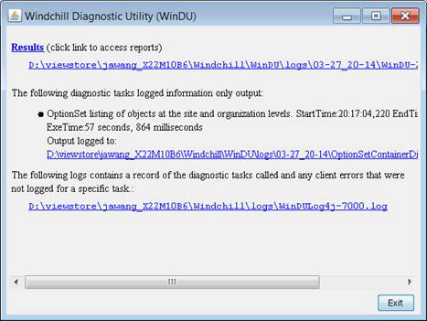
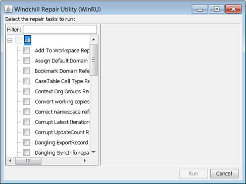
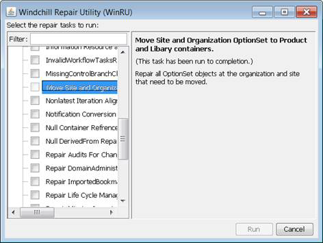

# Moving Objects Using WinDU and WinRU

> 来源：PTC Windchill Help Center（R13.1.2.0）  
> 原文：[PTC Help Center](https://support.ptc.com/help/windchill/r13.1.2.0/en/Windchill_Help_Center/options/OptionsWinduWinru.html)  
> 获取日期：2026-11-12

For target system, after an upgrade has been performed, the Site or Organization Administrator can move the migrated option sets (formerly known as Navigation Filter Template) and associated options and choices to the appropriate contexts using WinDU and WinRU tools.

The WinDU diagnostic task “OptionSet listing of objects at the site and organization levels” reports all OptionSet objects that belong to organizations and sites, which need to be moved to appropriate product or library contexts.

WinDU can be launched using the script named windu located in the $(wt.home)\\bin directory.

- On Windows, use the script $(wt.home)\\bin\\windu.bat

- On UNIX, use the script $(wt.home)/bin/windu.sh

These scripts must be run from a GUI shell running on the Windchill installation's host.

>  **Note:** These scripts cannot be run from a remote client.

Follow these steps to perform an automatic migration:

1. Start running the WinDU script.

2. A Swing application opens. Select the diagnostic tasks that you want to run or deselect the ones that you do not want to run using the checkboxes next to the names of the diagnostic tasks. In this case, select the “OptionSet listing of objects at the site and organization levels” task.

3. Select **Run**. WinDU attempts to confirm that the web server and servlet engines are running.

4. You are prompted to log into the Windchill instance as an administrator. Once you have succeeded, the diagnostic tasks start running in sequence.

5. After the diagnostic tasks are complete, WinDU informs you if any of the diagnostic tasks produced logged output and provides paths to the log files.

6. The output of the WinDU task is XML in $(wt.home)\\loadXMLFiles\\OptionSetContainerMappings.xml.

1. For example, assume that there is an option set in Windchill source system called “Bicycle Option Set Template” in “Demo Organization” OrgContainer. The OptionSetContainerMappings.xml is created, containing the option set name and its context.

<?xml version='1.0' encoding='UTF-8'?> <OptionSetContainerMappings> <mapping> <optionset>Bicycle Option Set Template</optionset> <container>/wt.inf.container.OrgContainer=Demo Organization</container> </mapping> </OptionSetContainerMappings>

1. You must manually update the OptionSetContainerMappings.xml context information to specify to which context this particular option set should be moved. In the example below, the context must be updated to /wt.inf.container.OrgContainer=Demo Organization/wt.pdmlink.PDMLinkProduct=Bicycle. This moves the option set to the Bicycle product context.

<?xml version='1.0' encoding='UTF-8'?> <OptionSetContainerMappings> <mapping> <optionset>Bicycle Option Set Template</optionset> <container>/wt.inf.container.OrgContainer=Demo Organization/wt.pdmlink.PDMLinkProduct=Bicycle</container> </mapping> </OptionSetContainerMappings>

7. A WinRU task has been created to read the updated OptionSetContainerMappings.xml and perform the move option set action. Similarly to WinDU, WinRU can be launched using the script named winru located in the $(wt.home)\\bin directory.

1. On Windows, run the script $(wt.home)\\bin\\winru.bat.

1. On Unix, run the script $(wt.home)/bin/winru.sh.

8. From the list, select **Move Site and Organization OptionSet to Product and Library containers** using the check boxes next to the name of the repair tasks. Click Run to start the repair task.

9. Once the repair task is complete, WinRU informs you if the repair task produced any logged output, and provide paths to the log files.

|  |  |
| --- | --- |
| **** | You can run WinRU for a given task only once. If you need to repeat the process, you must first restore the database to be able to run the task again. |

