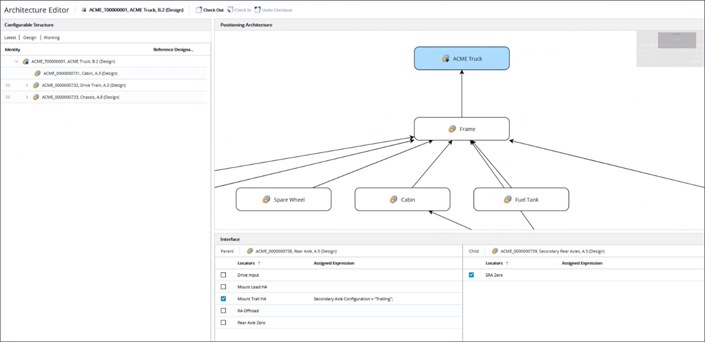

# Managing the Positioning Architecture in Architecture Editor

> 来源：PTC Windchill Help Center（R13.1.2.0）  
> 原文：[PTC Help Center](https://support.ptc.com/help/windchill/r13.1.2.0/en/Windchill_Help_Center/options/OptionsArchEditor.html)  
> 获取日期：2026-11-12

Use the **Open in Architecture Editor** action available for a configurable product to launch the **Architecture Editor**, where you can view and edit the positioning architecture for that product. The **Open in Architecture Editor** action is available from the **Actions** menu for a configurable part.

Refer the video for more details. To view the video in a larger window, click on the video title. This opens the video in YouTube in a new tab.

The positioning architecture defined in the **Architecture Editor** is used to capture the configuration logic that is used to assemble a configurable product. When configuring a product, the positioning architecture is used to build a dynamically positioned representation for that configured product and build a configured CAD variant for further design work.

The positioning architecture contains two key components:

- Configurable Modules: Configurable modules in the architecture are used to interchangeably represent any of the module variant children.

- Interfaces: Interfaces establish a positioning relationship between the two configurable modules.

The combination of these two elements describes the way in which any combination of the module variants associated with each configurable module is positioned.

The **Architecture Editor** user interface consists of the following panes:

- **Configurable Structure**: Displays the structure of the configurable product based on the latest configuration specification. Non-configurable parts are filtered and the structure is displayed in the occurrence mode. For more information, see [Occurrence Display](https://support.ptc.com/help/windchill/r13.1.2.0/en/Windchill_Help_Center/prodstructure/PMOccurrenceDisplay.html). The structure includes the **Identity** and **Reference Designator** columns. This pane also displays the current configuration specification applied to the configurable structure, which is defined as latest, and where the view is set to the view of the top-level configurable product, working copies included. The configuration specifications cannot be modified.

- In this pane, you can use the **Expand All**, **Expand by**, and **Collapse All** right-click actions to recursively expand or collapse the structure for a selected part. For more information on these actions, see [Viewing Action Set - Parts](https://support.ptc.com/help/windchill/r13.1.2.0/en/Windchill_Help_Center/prodstructure/PMActionSetViewing.html).

- **Positioning Architecture**: Displays a graph of the connected nodes that are used to define how to assemble a configurable product. A node represents a configurable module and a connection represents an interface between the configurable modules. To add a node, drag a configurable module from the part structure and drop it onto the graph. To add an interface, create a connection from a child node to a parent node in the graph.

|  |  |
| --- | --- |
| **** | • Selecting a row in the configurable structure selects the corresponding node in the positioning architecture graph if the configurable module is already added to the graph. If you select a different node or interface in the graph, the row that was previously selected in the configurable structure becomes unselected.• A child may be connected to multiple parents, however only one interface should remain after a product is configured. Otherwise, the system displays an error message that the position of the child module variant cannot be calculated.• When you start updating the positioning architecture, the top-level configurable product is automatically checked out. |

- To delete a node or an interface from the graph, click the node or the interface and select the **Remove** right-click action. When a node is deleted, all the interfaces connected to that node are also removed. Using the **Remove** action deletes an interface and the assigned expressions defined for the selected locators on that interface. Alternatively, you can also use the **Delete** key on the keyboard to delete a node or an interface.

- **Interface**: Displays the selection of locators that can be used to position the connected parent and child configurable modules. Assigned expressions defined on the locators determine which locators will be used when configuring the product.

|  |  |
| --- | --- |
| **** | When a connection is displayed as a dashed line in the graph, this indicates that the interface is partially defined, that is, the locators for both or either the parent or child configurable modules have not been selected. |

## Steps for Defining a Positioning Architecture

To define a positioning architecture for a configurable product, perform the following steps:

1. Define a configurable product structure. For more information, see [Support for Configurable Structures and Platform-Based Products](../../01-windchill-opt-7075e8a3/01-enabling-func-f29c0bc6/index.md).

2. Define locators for lower-level configurable modules.

1. From the part structure for the configurable product, open the **Locators** tab.

1. Select the lower-level configurable modules.

1. Define locators that represent a conceptual positioning location.

3. Define positioning architecture for configurable module.

1. Launch the **Architecture Editor** by selecting the **Open in Architecture Editor** action from the **Actions** menu for the configurable product.

1. Add a node to the graph by dragging configurable module from the configurable structure to positioning architecture graph.

1. Add an interface by drawing connections between child and parent configurable module nodes.

1. Select the connection and in the **Interface** pane, perform the following steps:

1. Select locators that can be used to position child and parent configurable modules.

1. Define choice expressions for selected locators based on the option filter assigned to configurable product.

1. Repeat steps from b to d until all nodes and interfaces have been defined.

After you have defined the positioning architecture, when configuring a product, the system dynamically builds a positioned representation based on the product configuration and positioning architecture. You can then view the representation in the **Visualization** tab in the part structure browser.

>  **Note:** If the configured product contains overloaded results, that is, a configurable module is resolved with multiple module variants, the system may not be able to position that module.

You can open the resulting positioned product in a CAD session by creating a configuration context and using the **Open In CAD Tool** action. For more information, see [Opening the Platform Structure in a CAD Application](../04-opening-the-p-90f58346/index.md#wwID0EKF3S "Opening the Platform Structure in a CAD Application").
