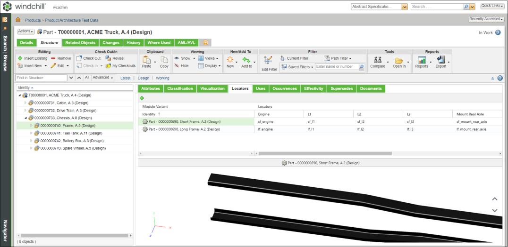
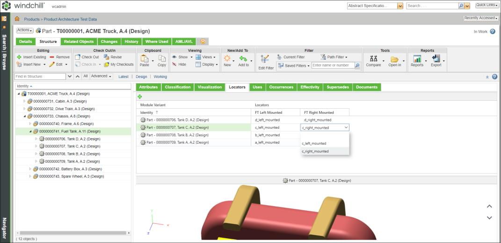
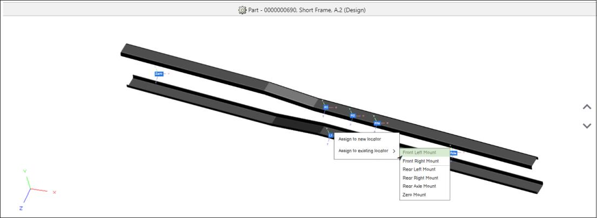
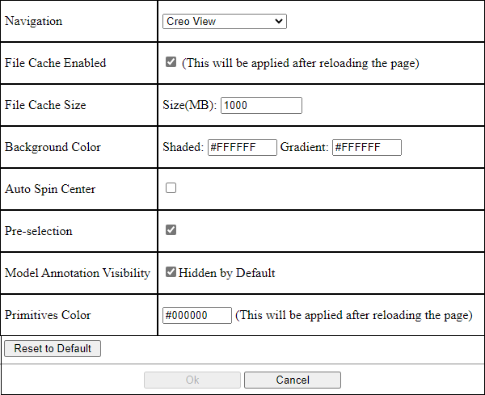

# Managing Locator Definitions in Locators Tab

> 来源：PTC Windchill Help Center（R13.1.2.0）  
> 原文：[PTC Help Center](https://support.ptc.com/help/windchill/r13.1.2.0/en/Windchill_Help_Center/options/OptionsLocEditor.html)  
> 获取日期：2026-11-12

Within the part structure browser for a configurable product, the **Locators** tab is available that allows you to view and manage locators for a configurable module and map locators to module variant coordinate systems exposed from the CAD design.

Refer the video for more details. To view the video in a larger window, click on the video title. This opens the video in YouTube in a new tab.

## Locators Table

When a configurable module is selected in the part structure browser for a configurable product, the **Locators** tab displays a table that includes the module variants and locators defined for the configurable module. The **Locators** table has two main columns:

- **Module Variants**: For a selected configurable module, only the module variant children, also known as non-configurable parts, are displayed in the **Locators** table with a type icon and part identity (number, name, version).

- **Locators**: You can add a new locator for a configurable module by clicking  in the **Locators** table and providing a name. You can map a locator to a module variant coordinate system by double clicking a cell in the **Locators** column and selecting from the list of coordinate systems exposed from the CAD design.

## Visual Representation in the Locators Tab

When you select a module variant in the **Locators** table, a visual representation of the module variant is displayed in the visualization panel below the table. Within the visualization panel, you can update the selected module variant in the **Locators** table by using the previous and next actions displayed as up and down arrows.

## Creating a Locator for a Configurable Module

Prerequisite:

- To create a locator for a configurable module, you must have the modify access to the configurable module.

- The configurable module must not be checked-out by other users.

To create a locator for a configurable module, follow these steps:

1. Click  in the **Locators** table. A **New Locator** dialog opens.

|  |  |
| --- | --- |
| **** | • If the configurable module is checked-in and you click **New Locator** action, the configurable module is checked-out automatically.• If you cancel the **New Locator** dialog, the configurable part remains in the checked-out state. |

2. Add a name for the locator.

3. Click **OK**. The locator is displayed as a new column in the table.

|  |  |
| --- | --- |
| **** | You can display the name of the  **New Locator** action in the toolbar by setting the **Toolbar Action Descriptions** preference to **Yes**. By default, this preference is set to **No**. |

## Renaming a Locator for a Configurable Module

Prerequisite:

- To rename a locator for a configurable module, you must have the modify access to the configurable module.

- The configurable module must not be checked-out by other users.

To rename a locator for a configurable module, follow these steps:

1. In the locator column you want to rename, select the **Rename** action from the column header actions menu. A **Rename** dialog opens.

|  |  |
| --- | --- |
| **** | • If the configurable module is checked-in and you click **Rename** action, the configurable module is checked-out automatically.• If you cancel the **Rename** dialog, the configurable part remains in the checked-out state. |

2. Update the name for the locator.

3. Click **OK**. The name in the column header is updated.

## Deleting a Locator for a Configurable Module

Prerequisite:

- To delete a locator for a configurable module, you must have the modify access to the configurable module.

- The configurable module must not be checked-out by other users.

To delete a locator for a configurable module, follow these steps:

1. In the locator column you want to delete, select the **Delete** action from the column header actions menu. A **Delete** confirmation dialog opens.

|  |  |
| --- | --- |
| **** | • If the configurable module is checked-in and you click **Delete** action, the configurable module is checked-out automatically.• If you cancel the **Delete** dialog, the configurable part remains in the checked-out state. |

2. Click **OK**. The locator is deleted, and the column is removed from the table.

## Mapping Module Variant Coordinate Systems to Locators

To map the coordinate systems to a module variant, the coordinate systems must be designated as locators in the CAD design to be used in Windchill. This allows Creo View Adapters to convert the coordinate systems information and expose it to Windchill when publishing the representation and viewing the module variants. For more information, see the **Converting the Locator for the Platform Structure Visualization** section in the [Creo View Help Center](https://support.ptc.com/help/creo/view/r11.1/en/).

You can map a locator to a module variant coordinate system by double-clicking the intersecting cell for a module variant row and locator column in the **Locators** table. This will put the cell in edit mode, where you can select from a list of coordinate systems defined in module variant representation exposed from the CAD design.

When viewing the assigned coordinate systems in the **Locators** table:

- If you select a cell with a selected coordinate system, the corresponding coordinate system is highlighted in the visual representation for the module variant.

|  |  |
| --- | --- |
| **** | You cannot select multiple cells at a time in the **Locators** table. |

- If you select a coordinate system in the visual representation, the cells with the same selected coordinate systems are highlighted in the **Locators** table.

Within the visual representation, you can select and map a coordinate system to an existing locator or a new locator. To do this, follow these steps:

1. In the visual representation for a module variant, right-click on a coordinate system. A right-click action menu is displayed.

2. Select either **Assign to new locator** action or **Assign to existing locator** action.

- **Assign to new locator**: Allows you to create a new locator and map the selected coordinate system to it. When you select this action, a **New Locator** dialog box opens, where you can define the locator name. The new locator is displayed as a new column in the **Locators** table and the selected coordinate system will be mapped to the locator.

- **Assign to existing locator**: Allows you to map the selected coordinate system to an existing locator. When hovering over the action, a list of existing locators is displayed. After selecting a locator, the coordinate system will be mapped to the locator and appear in the intersecting cell between the module variant row and locator column in the **Locators** table.

>  **Note:** In the visual representation, if you select a locator in the action menu and the configurable module is not checked-out, the system automatically checks out the configurable module.

## Editing the Visualization Preference from the Locator Tab

You can view and edit the visualization preference in the **Locators** tab by pressing Shift + P key. This opens the viewer preference window. Make changes in this window as needed and click **OK**. When the 3D view of the configurable part is rendering, a progress indicator is displayed in the visualization panel.

>  **Note:** The **Pre-selection** functionality, available in the Creo View WebGL Preferences dialogue box and part selection, is not supported in the visualization panel on the **Locators** tab.
