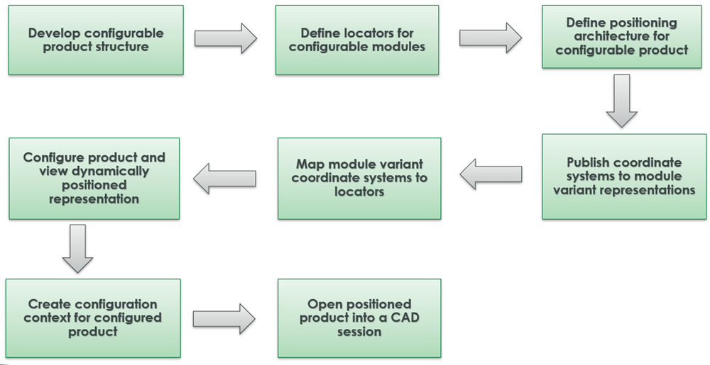
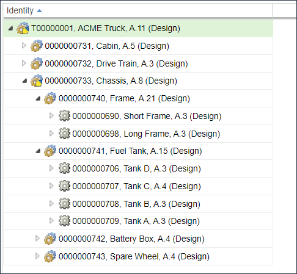
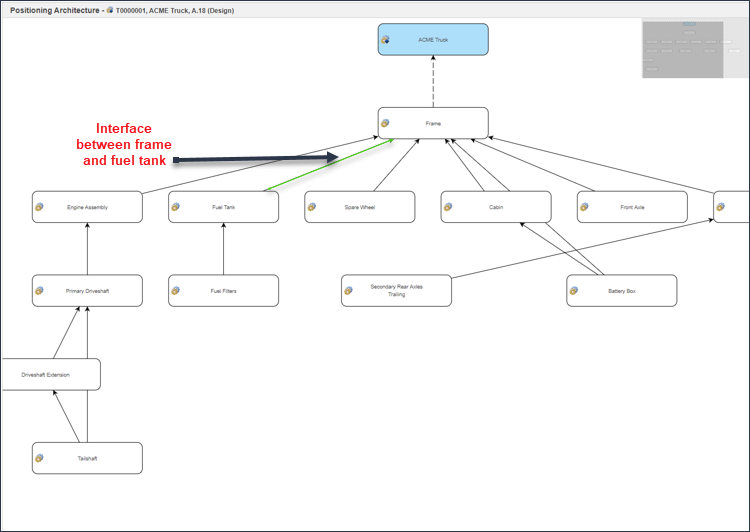
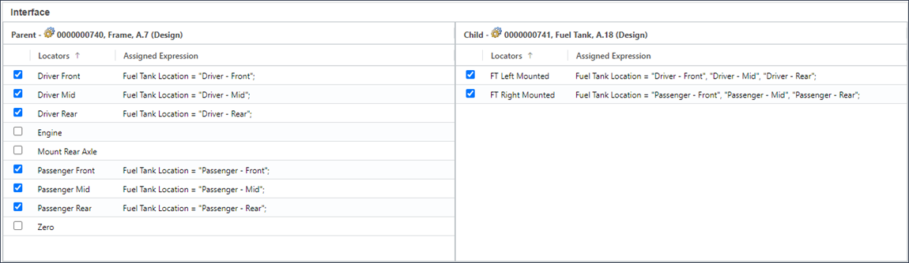
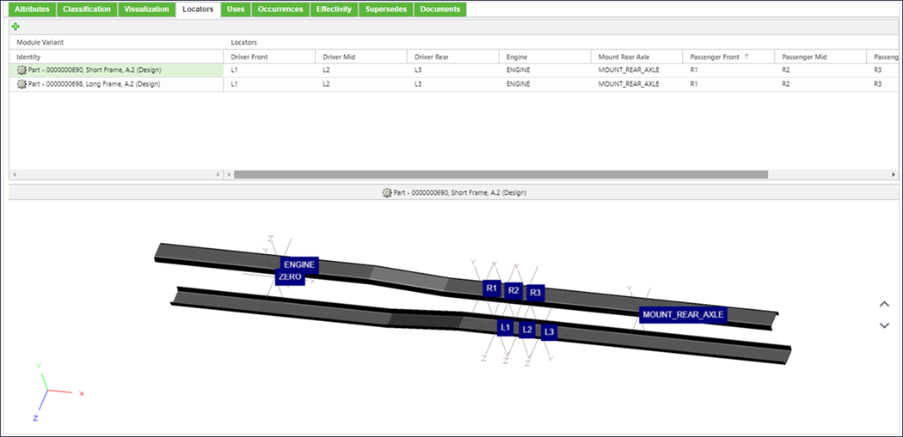
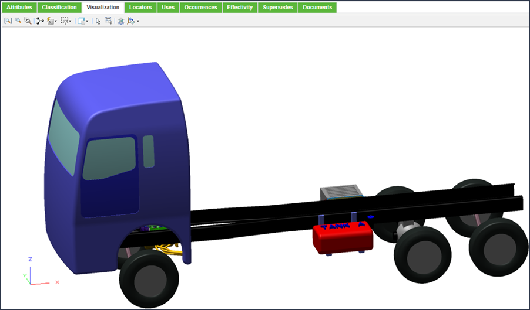

# Dynamic Positioning with Options and Variants

> 来源：PTC Windchill Help Center（R13.1.2.0）  
> 原文：[PTC Help Center](https://support.ptc.com/help/windchill/r13.1.2.0/en/Windchill_Help_Center/options/OptionsDynVisOview.html)  
> 获取日期：2026-11-12

Dynamic Visualization along with advanced configurable products and modules provides a strategic set of capabilities that you can use to create configuration-driven deliverables. The dynamic positioning capability enables Windchill to capture the assembly positioning logic and use it to visualize and build CAD variants for the configured product. This eliminates the need for maintaining this overloaded information in the CAD model and product structure to create the same configuration driven deliverables.

The positioning architecture helps to capture the configuration logic that is used to assemble a configurable product. The positioning architecture establishes the spatial relationship between configurable modules in a configurable product. An interface connects the parent and child configurable modules together and defines the logic for the relative positioning through the usage of locators. A locator represents a conceptual location defined for a configurable module. These conceptual locators used within the positioning architecture are mapped to a coordinate system exposed from the CAD design. The resulting position of the configurable modules in a configurable product are calculated by aligning the locators of the parent and child configurable modules of an interface.

To utilize this capability, the following user interfaces are available in Windchill:

- **Architecture Editor**: Allows you to define the positioning architecture for a configurable product. This can be launched by selecting the **Open in Architecture Editor** action from the **Actions** menu available for the configurable product. For more information, see [Managing the Positioning Architecture in Architecture Editor](01-managing-the-48164bce/index.md#wwID0ECHZS "Managing the Positioning Architecture in Architecture Editor").

- **Locators** tab: Allows you to define locators for a configurable part and map the coordinate systems defined in module variant representations to the locators. This tab is available within the part structure browser. For more information, see[ Managing Locator Definitions in Locators Tab](02-managing-loca-3a9b6386/index.md#wwID0ELM1S "Managing Locator Definitions in Locators Tab").

>  **Note:** The **Open in Architecture Editor** action and the **Locators** tab are available only when the **Configurable Module Support** preference is enabled.

After you have defined the positioning architecture, when viewing a configured product in the **Visualization** tab the application automatically positions the configurable modules according to the positioning architecture defined. You can open the resulting positioned product in a CAD session for continued design analysis and downstream work.

## Dynamic Positioning Workflow

The following diagram illustrates the typical dynamic positioning workflow:

## Terminology

The key terms used in dynamic positioning are:

- **Positioning Architecture**: Positioning architecture is a graph that is defined by configurable module nodes and connectors, which captures the configuration logic and describes how components of a configurable product are assembled.

- **Interface**: An interface defines a relationship that can be used for assembling child to parent configurable modules defined within the positioning architecture. Assigned expressions are used to select the locators that must be used when building a configured product.

- **Locator**: A locator represents a conceptual location defined for a configurable module, which is used to assemble child and parent configurable modules. Locators are mapped to coordinate systems for each module variant in the configurable module. These coordinate systems are exposed from the CAD design. For more information, see the **Converting the Locator for the Platform Structure Visualization** topic in the [Creo View Help Center](https://support.ptc.com/help/creo/view/r11.1/en/). By establishing this mapping between the configurable module locator and coordinate system in each module variant, Windchill can use the positioning architecture to calculate the position for each module variant interchangeably.

For more information about the key terms related to options and variants, see [Terminology Used In Options and Variants](https://support.ptc.com/help/windchill/r13.1.2.0/en/Windchill_Help_Center/ccm_oview/OptionsTerminology.html).

Consider an example of a configurable product “Truck” that contains a frame configured for multiple lengths and a fuel tank configured with multiple solutions that can be assembled at different positions on the frame.

The assembly point between the frame and fuel tank is represented by an interface.

The interface will use locators to describe where the fuel tank can be assembled. In the example below, the fuel tank can be left or right mounted and can be positioned in the "Driver Front", "Driver Mid", or "Driver Rear" positions on the frame. The selection of the positions to be used is done through assigning expressions against the locators.

The locators will be mapped to the coordinates systems present in the designs for each frame and fuel tank option:

When viewing a configured product in the **Visualization** tab, you can now view the positioning of the fuel tank calculated based on the positioning architecture:

