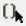

# Case Table Editor

> 来源：PTC Windchill Help Center（R13.1.2.0）  
> 原文：[PTC Help Center](https://support.ptc.com/help/windchill/r13.1.2.0/en/Windchill_Help_Center/options/OptionsCaseTableEditor.html)  
> 获取日期：2026-11-12

Case tables provide an easy way to specify constraints for a configurable module. A case table specifies permissible sets of values for a set of configurable module parameters used in the Configuration action. Case tables allow placing limits on parameters when those limits cannot be expressed as value expressions, or when they are restrictive, or the constraints are loose. A configurable module can have any number of case tables.

To display the **Case Table Editor**, select **Case Table** from the **Constraint Type** drop-down list on the **Constraints** tab. The **Case Table Editor** is displayed immediately below the **Constraints** pane. The **Case Table Editor** provides the following options:

<table border="1">
              <tr>
                <th>
                  
Icon

                </th>
                <th>
                  
Description

                </th>
              </tr>
              <tr>
                <td>

 Select Parameter

</td>
                <td>
                  
Defines the parameters included in the case table. For more information, see <a href="03-selecting-cas-7943f856/index.md#wwID0EEEET">Selecting Case Table Parameters</a>.

                </td>
              </tr>
              <tr>
                <td>

 Generate Cases for Enumerated Parameters

</td>
                <td>
                  
Generates cases if the case table has one or more enumerative parameters (parameters that have a list of allowed values).

                </td>
              </tr>
              <tr>
                <td>

 Remove

</td>
                <td>
                  
Removes a selected row from the editor.

                </td>
              </tr>
              <tr>
                <td>

 Copy casetable to desktop

</td>
                <td>
                  
Copies the selected row or rows to the clipboard. These rows can then be pasted into an Excel spreadsheet.

                  

                    <table>
                      <tr>
                        <td>
                          
 

                        </td>
                        <td>
                          
The structure of the case table can be recreated in a new configurable module and populated using the copy and paste actions from your desktop.

                        </td>
                      </tr>
                    </table>
                  

                  

                    <table>
                      <tr>
                        <td>
                          
 

                        </td>
                        <td>
                          
This icon is not available for case tables containing conditional logic, keywords, or formulae.

                        </td>
                      </tr>
                    </table>
                  

                </td>
              </tr>
              <tr>
                <td>

 Paste casetable from desktop

</td>
                <td>
                  
Pastes the selected data into the table. Data can be pasted from an Excel spreadsheet.

                  

                    <table>
                      <tr>
                        <td>
                          
 

                        </td>
                        <td>
                          
This icon is not available for case tables containing formulae or when the selected data contains conditional logic or keywords.

                        </td>
                      </tr>
                    </table>
                  

                </td>
              </tr>
            </table>

## Editing Parameters in a Case Table

A case table specifies permissible sets of values for a selected set of parameters. The actions to set the values depend on the parameter type, parameter constraints, and whether the **Enable Advanced Case Tables** preference is enabled. Clicking the  **Edit Case Table Parameter** icon in **Case Table Editor** opens the **Edit Case Table Parameter** window, where you can add parameters for which you want to add columns. Each parameter is listed in a separate column in the table.

When the **Enable Advanced Case Tables** preference is enabled, the case table allows values to be set using the **Edit Case Table Parameter** icon, or the  **Edit Parameter Formula** icon for parameter types that allow the use of conditional logic, keywords, or formulae.

When the **Enable Advanced Case Tables** preference is disabled, the case table allows values to be specified inline or using the  **Specify Range** icon.

For more information, see:

- [Editing a Case Table Parameter](01-editing-a-cas-3b3804f7/index.md#wwID0ELNDT "Editing a Case Table Parameter")

- [Editing a Parameter Formula](02-editing-a-param-4b0554/index.md#wwID0EA1DT "Editing a Parameter Formula")

- [Specifying a Parameter Range](../../01-adding-a-parameter/01-editing-a-parameter/02-constraint-ta-37f5a979/01-specifying-a-pa-eb4b86/index.md#wwID0EZH6S "Specifying a Parameter Range")

- [Using Numeric Operators and Functions in Advanced Logic](../../07-using-numeric-34971aaf/index.md#wwID0E6GGT "Using Numeric Operators and Functions in Advanced Logic")
