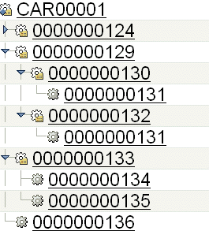
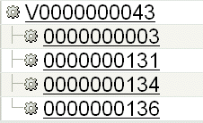

# Creating Module Variants with Collapsible Middle Nodes

> 来源：PTC Windchill Help Center（R13.1.2.0）  
> 原文：[PTC Help Center](https://support.ptc.com/help/windchill/r13.1.2.0/en/Windchill_Help_Center/options/OptionsVariantCollapsible.html)  
> 获取日期：2026-11-12

If a configurable module is defined as collapsible, then when generating a variant, it is replaced by its child standard part, and the quantity of standard parts is adjusted accordingly. The quantity of parts is set as defined in the Part Structure Browser.

For example, a configurable module Tire has two interchangeable standard parts with different tire characteristics (each with quantity of 1). If the Tire part is defined as collapsible, in the resulting deliverable the configurable module is replaced by the child part that matches the variant specification. If the configurable module has quantity 4, then the quantity of the standard part takes into account the quantity of the configurable module, and it this case lists the quantity of 4.

The ability to collapse the configurable modules allows you to streamline the structure to show the actual parts that are used to create a product. The next figure shows a structure that includes configurable modules.

If all configurable modules at middle nodes are defined as collapsible, then the deliverable generated from this structure using a variant specification produces a simplified variant structure, as shown in the next figure.

