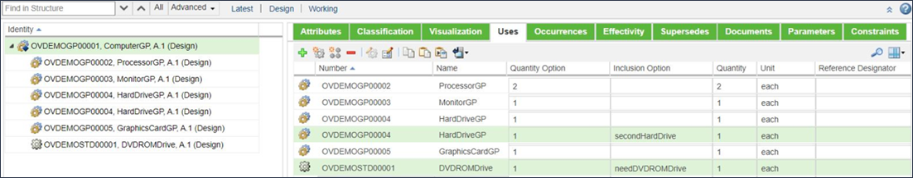

# Enabling a Single Option Based on a Yes/No Response

> 来源：PTC Windchill Help Center（R13.1.2.0）  
> 原文：[PTC Help Center](https://support.ptc.com/help/windchill/r13.1.2.0/en/Windchill_Help_Center/options/WCOVEnabSglOptYesNoResp.html)  
> 获取日期：2026-11-12

In many situations, you may want to enable or disable a single option based on a user response to a yes/no question. For example, you may want to determine whether the user wants a particular option package.

To enable a single feature based on a yes/no user response:

1. Create a configurable module.

2. Attach a child part that represents the relevant option.

3. Add a boolean input parameter to the configurable module.

4. Define an appropriate prompt value for this parameter.

5. Add this boolean parameter to the **Inclusion Option** of this configurable module for the child part.

The following figure shows an example of this technique where the HardDriveGP and DVDROMDrive are or are not included by the value of the boolean parameters secondHardDrive and needDVDROMDrive, respectively.

