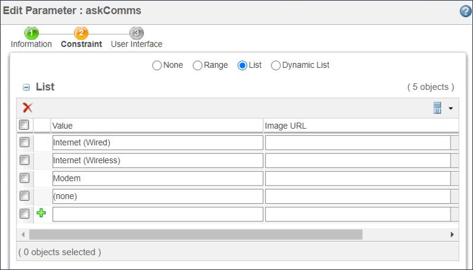
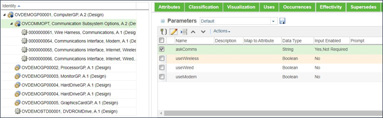
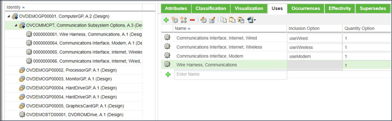

# Selecting One Option from a Set of Several Possible Options

> 来源：PTC Windchill Help Center（R13.1.2.0）  
> 原文：[PTC Help Center](https://support.ptc.com/help/windchill/r13.1.2.0/en/Windchill_Help_Center/options/WCOVSelOneOptFrmSevOpts.html)  
> 获取日期：2026-11-12

You may want to select a single option from a set of several possible options, based on the user’s response. For example, a remote power generation system can be available with three different communications and monitoring systems—modem, wired internet, and wireless internet, and you want to enable the correct system based on the user’s response.

To select a single option from a set of possible options:

1. Create a configurable module.

2. Attach a child part for each of the relevant options.

3. Add a string input parameter to the configurable module; for example, askComms.

- Define an appropriate prompt value for the string parameter.

- Define a set of constraints for the string parameter, such as:

- Internet (Wireless)

- Internet (Wired)

- Modem

4. Add three boolean non-input parameters to the configurable module, such as:

- useWireless— to represent the usage of the Internet (Wireless) system

- useWired— to represent the usage of the Internet (Wired) system

- useModem— to represent the usage of the Modem system

1. In this example, the user’s response is captured in the parameter askComms that is constrained to three possible values. Based on the user’s response, one of the boolean parameters is set to True by the case table constraint that enables the corresponding subassembly.

