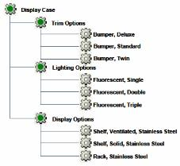

# Designing a Module Product Structure

> 来源：PTC Windchill Help Center（R13.1.2.0）  
> 原文：[PTC Help Center](https://support.ptc.com/help/windchill/r13.1.2.0/en/Windchill_Help_Center/options/WCOVDesignModProdStruc.html)  
> 获取日期：2026-11-12

Many products have a number of subsystems that have their own sets of optional elements. In some cases, the options for each subsystem are processed independently by the system in a logical progression. However, in other cases, it may be necessary for the available options in one subsystem to be affected by the selections made in other subsystems.

For example, consider a metal display case that is available in several different models with a variety of display, trim, and lighting options. Depending on the display case model selected, the options that are available for the display, trim, and lighting elements may be different.

For a simple product structure with only a few modules and a limited set of options, it is relatively easy to create and test a suitable configurable product structure. However, if the product structure has as few as five modules, each with six possible options to choose from, the total number of permutations (5 x 6 or 30, in this case) can be overwhelming.

The suggested approach is to organize the module’s product structure into configurable modules, as shown in the following figure.

For this example, assume that the display case is available in five different models, Model\_01 through Model\_05, and that some of the options are only applicable to certain models, as shown in the following table.

| Display Case Model | Trim Options | Lighting Options | Display Options |
| --- | --- | --- | --- |
| Model\_01 | Twin Standard | Single Double | Shelf, Ventilated Shelf, Solid |
| Model\_02 | Standard Deluxe | Double, Triple | Shelf, Ventilated Shelf, Solid |
| Model\_03 | Twin Standard Deluxe | Single Double Triple | Shelf, Ventilated Rack |
| Model\_04 | Twin Standard Deluxe | Single Double Triple | Shelf, Ventilated Shelf, Solid Rack |
| Model\_05 | Twin Standard Deluxe | Single Double Triple | Shelf, Ventilated Shelf, Solid Rack |

The next step is to establish the appropriate logic elements in a modular fashion so that each option module can be tested independently and then integrated into the full product structure. For example, consider the logic for the Trim Options module. This module requires four parameters as follows:

askModel

- String, Input Parameter

- Prompt = “(TRIM OPTIONS) Select the desired display case model”

- Constraint:“Model\_01”, “Model\_02”, “Model\_03”, “Model\_04”, “Model\_05”

- “hide when driven” = true

useStandard

- Boolean, non-input parameter

- Added to the Inclusion Option in the **Uses** tab of the Display Case configurable module for the Bumper, Standard part

useTwin

- Boolean, non-input parameter

- Added to the Inclusion Option in the **Uses** tab of the Display Case configurable module for the Bumper, Twin part

useDeluxe

- Boolean, non-input parameter

- Added to the Inclusion Option in the **Uses** tab of the Display Case configurable module for the Bumper, Deluxe part

Next, you need a case table such as pickTrim to control the applicability of the trim options for each model of the display case, as shown in the following table.

| Display Case Model | Trim Options | Lighting Options | Display Options |
| --- | --- | --- | --- |
| Model\_03 | TwinStandardDeluxe | SingleDoubleTriple | Shelf, Ventilated Rack |
| Model\_04 | TwinStandardDeluxe | SingleDoubleTriple | Shelf, Ventilated Shelf, Solid Rack |
| Model\_05 | TwinStandardDeluxe | SingleDoubleTriple | Shelf, Ventilated Shelf, Solid Rack |

The next step is to establish the appropriate logic elements in a modular fashion, so that each option module can be tested independently and then integrated into the full product structure. For example, consider the logic for the Trim Options module. This module requires four parameters as follows:

askModel

- String, Input Parameter

- Prompt = “(TRIM OPTIONS) Select the desired display case model”

- Constraint:“Model\_01”, “Model\_02”, “Model\_03”, “Model\_04”, “Model\_05”

- “hide when driven” = true

useStandard

- Boolean, non-input parameter

- Added to the Inclusion Option in the Uses tab of the Display Case configurable module for the Bumper, Standard part

useTwin

- Boolean, non-input parameter

- Added to the Inclusion Option in the **Uses** tab of the Display Case configurable module for the Bumper, Twin part

useDeluxe

- Boolean, non-input parameter

- Added to the Inclusion Option in the **Uses** tab of the Display Case configurable module for the Bumper, Deluxe part

Next, you need a case table such as pickTrim to control the applicability of the trim options for each model of the display case, as shown in the following table.

|  |  |  |  |
| --- | --- | --- | --- |
| askModel | useStandard | useTwin | useDeluxe |
| Model\_01 | yes | yes | no |
| Model\_02 | yes | no | yes |
| Model\_03 | yes | yes | yes |
| Model\_04 | yes | yes | yes |
| Model\_05 | yes | yes | yes |

These logic expressions allow you to test the Trim Options module independently, so that you can ensure that everything is working as you intended.

|  |  |
| --- | --- |
| **** | If you use the same approach for each of the modules, though, the user is asked repeatedly what model of Display Case they want, which is undesirable. Therefore, after you create each of the modules and verify that they work correctly, you need to integrate them together. |

To integrate the modules:

1. Create a suitable parameter to determine the model within the Display Case configurable module as follows:

- askModel – String, Input Required Parameter

- Prompt = “Select the desired display case model”

- Constraint:“Model\_01”, “Model\_02”, “Model\_03”, “Model\_04”, “Model\_05”

2. Establish an equivalency between askModel in the Display Case configurable module and all of its descendants.

3. Remove the constraints for each askModel parameter in each of the option modules.

|  |  |
| --- | --- |
| **** | Removing these constraints is necessary to avoid conflicts between the Display Case top-level configurable module and the configurable modules that comprise each module. |

4. Test the completed configurable product structure. Because you have already tested each of the modules, you only need to verify that the value of askModel entered by the user in the Display Case top-level configurable module is correctly copied to each of the modules.

|  |  |
| --- | --- |
| **** | If you display the BOM Tree in the Set Parameters page of the **Configure** window and use the **Apply** button, you can quickly see whether the current value of askModel in the Display Case configurable module has been copied to each of the modules. |
