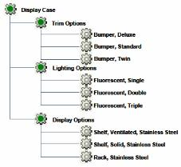
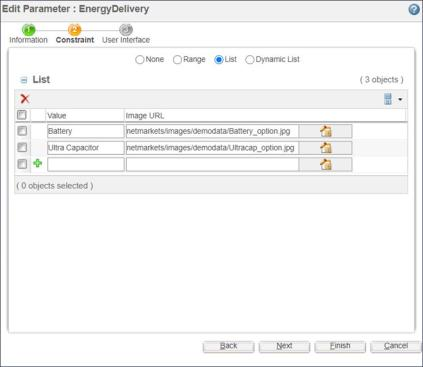

# Passing Parameter Values between Sections of a Product Structure Using Equivalencies

> 来源：PTC Windchill Help Center（R13.1.2.0）  
> 原文：[PTC Help Center](https://support.ptc.com/help/windchill/r13.1.2.0/en/Windchill_Help_Center/options/WCOVPassParamValUsingEquiv.html)  
> 获取日期：2026-11-12

One of the most common techniques for passing information between sections of a product structure involves using equivalencies. This technique is most commonly used to pass information from a parent object down to many or all of its child objects.

For example, you might have a Display Case that consists of several different components as shown in the following figure.

In order to create an equivalency, you select the **Equivalency** tab in the **Edit Parameter** window shown in the following figure.

For each equivalency, you have the option to specify a **Descendant** part (from a list of immediate subparts) or specify **All** to select all subparts of the product structure. You can also specify a **Parameter** (from a list of same-type parameters in the immediate subpart). If a specific parameter is not selected, then it is assumed that all parameters with the same name and type in the descendent parts are selected. For **Value**, you can select **Actual** to assign the actual value of the equivalent parameter, or **Default** to assign the default value of the equivalent parameter to the actual value of this parameter.

In the following example, the Display Case is available in five different models, Model\_01 through Model\_05, and some of the options are only applicable to certain models, as shown in the following table.

| Display Case Model | Trim Options | Lighting Options | Display Options |
| --- | --- | --- | --- |
| Model\_01 | Twin Standard | Single Double | Shelf, Ventilated Shelf, Solid |
| Model\_02 | Standard Deluxe | Double, Triple | Shelf, Ventilated Shelf, Solid |
| Model\_03 | Twin Standard Deluxe | Single Double Triple | Shelf, Ventilated Rack |
| Model\_04 | Twin Standard Deluxe | Single Double Triple | Shelf, Ventilated Shelf, Solid Rack |
| Model\_05 | Twin Standard Deluxe | Single Double Triple | Shelf, Ventilated Shelf, Solid Rack |

In situations like this, the user specifies the model of the Display Case and that information needs to be communicated, or passed, between different sections of the product structure.

As an example, you might define a parameter such as askModel for the Display Case configurable module and then pass the value of this parameter to the configurable modules for each of the options.

In this case, because the objective is to share the value of this parameter from the Display Case configurable module to a number of child configurable modules in the structure, the suggested approach is to define an equivalency for the askModel parameter.
