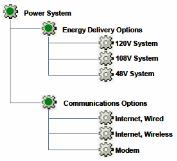
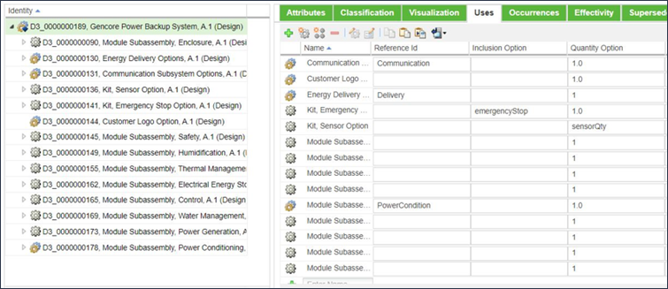
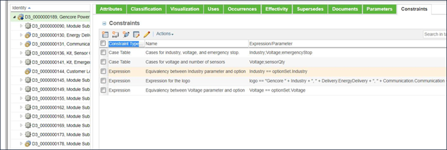

# Passing Parameter Values between Sections of a Product Structure Using Reference IDs

> 来源：PTC Windchill Help Center（R13.1.2.0）  
> 原文：[PTC Help Center](https://support.ptc.com/help/windchill/r13.1.2.0/en/Windchill_Help_Center/options/WCOVPassParamValUsingRefIDs.html)  
> 获取日期：2026-11-12

Another common technique for passing information between sections of a product structure involves the usage of Reference IDs. This technique is most commonly used when passing information between a parent object and one of its child objects or between a child object and a parent object that are separated by several levels. For example, you might have a Power System that consists of several different components as shown in the following figure.

In this example, the Power System is available in three different models with different voltage levels and three different communications options. In situations like this, the user specifies the desired model of the Power System and that information must be communicated, or passed, to the Energy Delivery Options section of the product structure but the information is not needed in the Communications Options section.

For example, you might define a parameter such as EnergyDelivery for the Energy Delivery Options configurable module or Communication for the Communication Subsystem Options configurable module and then use the value of these parameters in the top level configurable module to produce the logo of the company in the corresponding parameter. In this case, the suggested approach involves establishing a reference ID and a constraint.

To establish a reference ID and a constraint:

1. Establish a Reference ID, such as Delivery, for the Energy Delivery Options configurable module and Communication for the Communication Subsystem Options configurable module on the **Uses** tab of the Power System configurable module, as shown in the following figure:

2. Create a constraint for computing the value of the logo parameter in terms of the parameters EnergyDelivery and Communication in the corresponding subparts of the top level part:

logo == “Gencore “ + Industry + “.” + Delivery.EnergyDelivery + Communication.Communication

1. After the user provides the values for EnergyDelivery and Communicaton in the subpart of the Power System configurable module, their values are used to compute the value of the logo parameter for the top level configurable module.

1. You can also observe the use of the optionSet reference to establish an equivalency between the choices selection of an option in the option set and a value of a parameter:

PARAMETER\_NAME == optionSet.OPTION\_NAME.
