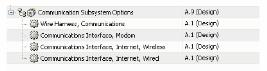
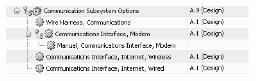

# Attaching Documents to a Configurable Product Structure

> 来源：PTC Windchill Help Center（R13.1.2.0）  
> 原文：[PTC Help Center](https://support.ptc.com/help/windchill/r13.1.2.0/en/Windchill_Help_Center/options/WCOVAttachDocToConfigProdStruc.html)  
> 获取日期：2026-11-12

In many cases, you may want to attach documents or other supporting information to a configurable product structure. For example, each of the Communication Interfaces may have their own installation and usage documentation as shown in the following figure.

Since the goal is to ensure that any product variant structure that includes a specific Communications Interface device also includes its corresponding documentation, the suggested approach is to attach the relevant supporting documentation to each device as shown in the following figure.

>  **Note:** This example illustrates a document that has been modeled as a part.

