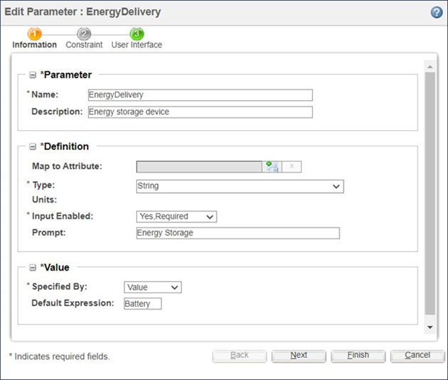
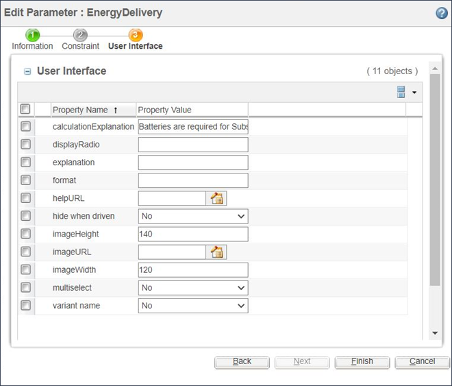

# Explaining Input Parameters that Users May Not Specify

> 来源：PTC Windchill Help Center（R13.1.2.0）  
> 原文：[PTC Help Center](https://support.ptc.com/help/windchill/r13.1.2.0/en/Windchill_Help_Center/options/WCOVExplainInputParamsNotSpec.html)  
> 获取日期：2026-11-12

In certain situations, user may select a specific option that automatically eliminates a subsequent option; however, if the same configurable product structure can be used in a variety of situations, the user may not understand why certain options can only be selected in certain situations and may become confused or frustrated.

For example, a particular Power Backup System can be used for Telecommunications and Substation applications. The Power Backup System generates electrical power using fuel cells and then stores the power until it is needed. Although the system can store the power it produces in batteries or ultra capacitors, industry regulations require batteries to be used for all substation applications.

To communicate this information to the user, the UI Property calculationExplanation can be used, as shown in the following figures.

This information is displayed to the user during the configuration process. In this example, the user specified an industrial application of substation, which automatically selected the energy storage device of batteries. The calculationExplanation text is displayed to the user to explain why this value was automatically selected.

>  **Note:** The calculationExplantion text is always displayed in the **Review Inputs** page enabled by setting the wpcfg.engine.display.inputReview.page=true property in WT\_HOME/codebase/com/ptc/wpcfg.properties file. It is not possible to dynamically change this text based on user’s selections.
