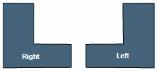
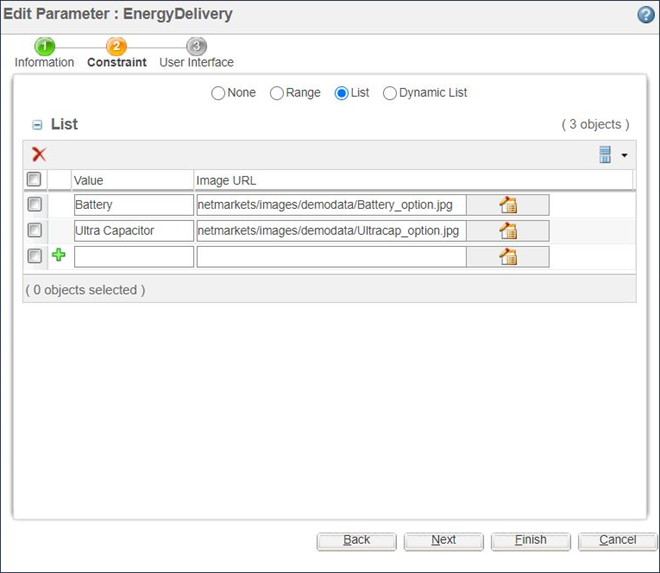
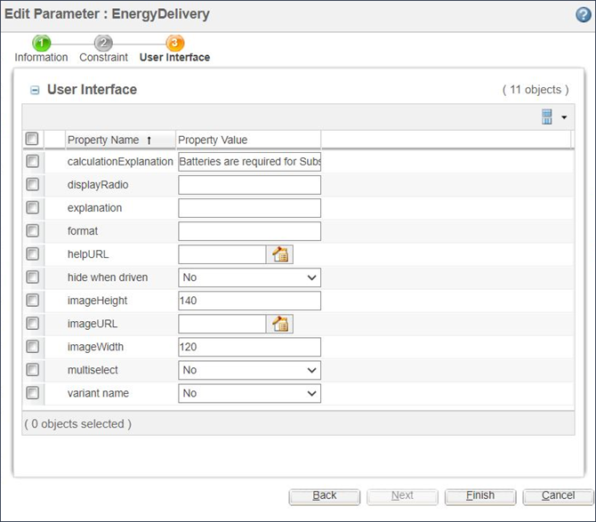

# Adding Images for Parameters with Enumerated Values

> 来源：PTC Windchill Help Center（R13.1.2.0）  
> 原文：[PTC Help Center](https://support.ptc.com/help/windchill/r13.1.2.0/en/Windchill_Help_Center/options/WCOVAddImagesParamsWithEnumVals.html)  
> 获取日期：2026-11-12

Adding appropriate images to a configurable product structure can greatly improve the clarity of the information that is presented to the user. For example, if asked to choose between two L-shaped brackets, one that points to the right and one that points to the left, the user may or may not understand what is meant. However, if provided with two distinct images, the user is more likely to understand the available options.

When parameters with enumerated values are defined, you may specify an image URL for each of the values and the Set Parameters page of the **Configure** window displays the image in conjunction with the value to help the user understand the possible values for each option.

As an example, in the Power Backup System configurable module, the system generates power using fuel cells and then stores the generated power in either ultracapacitors or batteries.

The enumerated values for the parameter askDelivery and the thumbnail images used with each value are specified on the **Constraint** tab as shown in the following figure.

When the “Select Parameter” page of the **Configure** window displays this parameter, a corresponding thumbnail image for each value is automatically displayed.

|  |  |
| --- | --- |
| **** | The properties imageHeight and imageWidth must be set as shown in the following figure to ensure that the size of the thumbnail image that is displayed in the “Select Parameter” page of the **Configure** window is appropriate. |

