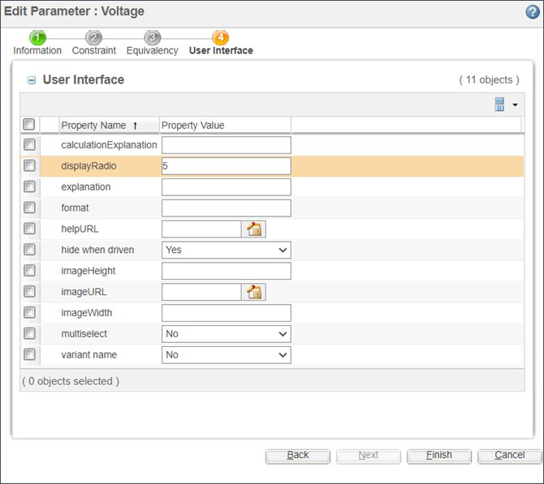

# Displaying Values as Radio Buttons

> 来源：PTC Windchill Help Center（R13.1.2.0）  
> 原文：[PTC Help Center](https://support.ptc.com/help/windchill/r13.1.2.0/en/Windchill_Help_Center/options/WCOVDispValsAsRadioButtons.html)  
> 获取日期：2026-11-12

The system automatically displays parameters with enumerated values as drop-down lists.

In some cases, especially when there are only a few possible values, it may be preferable to display the values as radio buttons as shown in the following figure. To enable this type of display, the UI property displayRadio must be set to a numerical value that is equal to or greater than the number of possible values for this parameter, as shown in the following figure.

If the number of possible values for the parameter exceeds the value defined for displayRadio, the values are displayed using the standard drop-down approach.

|  |  |
| --- | --- |
| **** | The displayRadio property uses the number of possible values for a parameter. Therefore, if you have a parameter with six possible values and a case table that constrains the parameter to only display three values at a time, you must define displayRadio with a value of 6 if you want to display these three values as radio buttons. |
