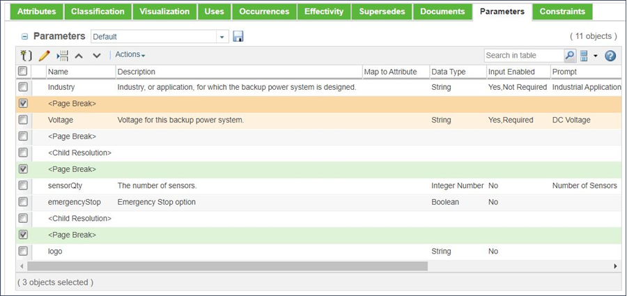

# Controlling Input Parameters Using Page Breaks

> 来源：PTC Windchill Help Center（R13.1.2.0）  
> 原文：[PTC Help Center](https://support.ptc.com/help/windchill/r13.1.2.0/en/Windchill_Help_Center/options/WCOVControlInputParamsPageBrks.html)  
> 获取日期：2026-11-12

In almost all situations, it is best to separate the input parameters for a configurable product structure into pages. For example, you may want to ensure that the response from one parameter is used to constrain the possible responses for a subsequent parameter, or you may want to limit the number of input parameters that are displayed on a single page. By default, the system automatically places all input parameters on a single page. Therefore, if you have a large number of input parameters, you must scroll the “Select Parameters” page of the **Configure** window vertically to access some of the input parameters.

In addition, the part configuration process evaluates all parameters on each page as a single operation. If you want to use the value of one parameter to constrain a subsequent parameter, you must divide these two parameters using a page break. Page breaks are defined in the **Parameters** tab for a configurable module as shown in the following figure.

