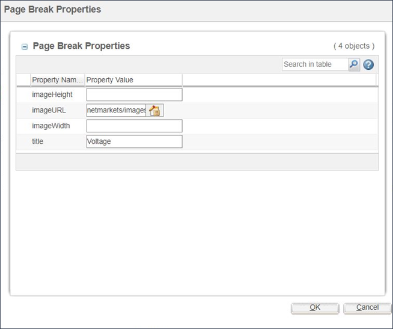
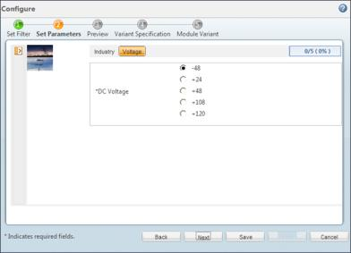

# Adding Titles and Images to Specific Parameter Pages

> 来源：PTC Windchill Help Center（R13.1.2.0）  
> 原文：[PTC Help Center](https://support.ptc.com/help/windchill/r13.1.2.0/en/Windchill_Help_Center/options/WCOVAddParamPageTitles.html)  
> 获取日期：2026-11-12

Each page of input parameters that is displayed in the **Set Parameters** page of the **Configure** process may include a title and an image. These titles and images a used to help organize the input parameters into logical groupings.

To specify the title and image for each successive parameter page:

1. From the **Parameters** tab of the part structure browser, select the page break immediately preceding the page that you want to modify and click on the **Edit** menu button just above the parameter list.

1. The **Page Break Properties** window appears as shown in the following figure.

2. In the **Property Value** column, enter the specifications for the page image and page title and click **OK**.

## Result

After you specify the image and title of a parameter page, they appear in the product **Configure** window as shown in the following figure.

