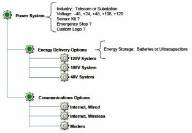
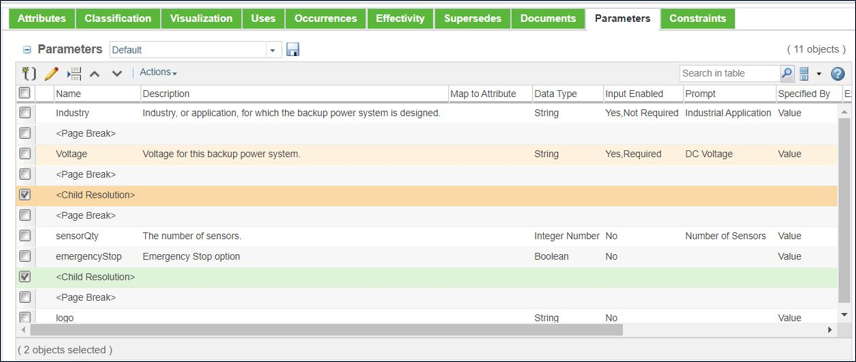

# Controlling the Order of Input Parameters Using Child Resolution

> 来源：PTC Windchill Help Center（R13.1.2.0）  
> 原文：[PTC Help Center](https://support.ptc.com/help/windchill/r13.1.2.0/en/Windchill_Help_Center/options/WCOVControlInputParamOrder.html)  
> 获取日期：2026-11-12

In some situations, you may want one or more input parameters from a child object to be processed in a particular order. For example, using the product structure shown in the following figure, the user is asked to select the industry and voltage for a Power System, and to include or not include a number of options. The options are: the Sensor Kit, the Emergency Stop, and the Custom Logo. The user is also asked to select a Communications Option, and to specify whether the energy generated by the system is stored in batteries or ultra capacitors.

Logically, it makes more sense to specify the Energy Storage immediately after the Voltage because these two product areas are related. The suggested approach is to insert a Child Resolution operation into the Parameter tab of the Power System configurable module, so that the system is instructed to process or resolve the input parameters of the child object first, as shown in the following figure.

