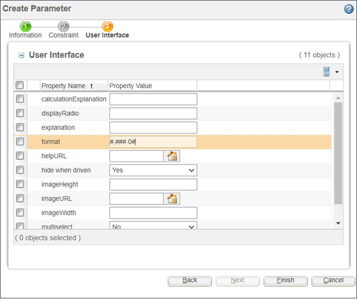

# Controlling the Display Format of Decimal Numbers

> 来源：PTC Windchill Help Center（R13.1.2.0）  
> 原文：[PTC Help Center](https://support.ptc.com/help/windchill/r13.1.2.0/en/Windchill_Help_Center/options/WCOVControlDisplayofDecimalNum.html)  
> 获取日期：2026-11-12

The parameter UI property format may be specified for decimal numbers (floats, doubles). The value of the property is a format pattern used by java.textDecimalFormat to format the value for display in the **Configure** window. If the format is set, then the value of the corresponding parameter is displayed in the **Configure** window in that format. Similarly, values in the parameter field must be entered according to the format pattern. For further details and an explanation of how the value will look after the application of the pattern, see the javadoc for the DecimalFormat class.

The value of the format property for a parameter is specified in the **Edit Parameter** window under the **User Interface** tab as shown in the following figure.

