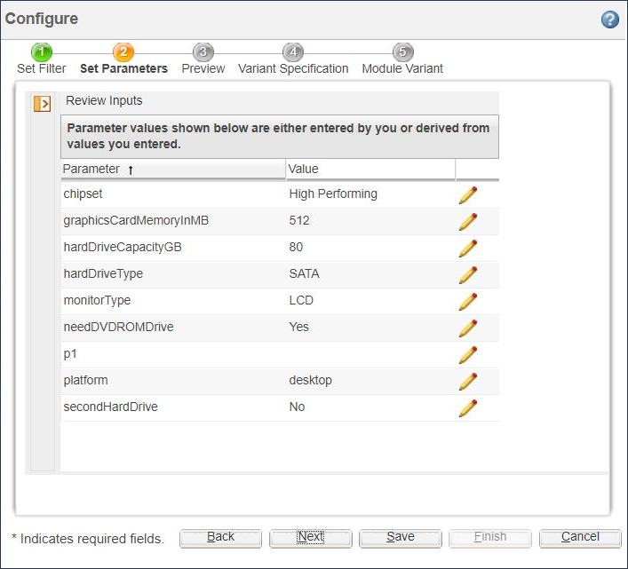

# Enabling the Input Review Page in Configure Wizard

> 来源：PTC Windchill Help Center（R13.1.2.0）  
> 原文：[PTC Help Center](https://support.ptc.com/help/windchill/r13.1.2.0/en/Windchill_Help_Center/options/OptionsEnableInputRevPage.html)  
> 获取日期：2026-11-12

If you set the property wpcfg.engine.display.inputReview.page=true in the WT\_HOME/codebase/com/ptc/wpcfg/wpcfg.properties file, an input review page is generated in the **Configure** wizard after you are done with navigating through the input pages and before generating the first solution page.

The input review page lists all the input parameters in the order that they are defined. To change the value of any of these parameters, select the parameter row and click the **Edit**  icon. This takes you to the page where the parameter is defined. Now, you can enter the new value and navigate through all the consecutive pages of the wizard to generate a new solution.

