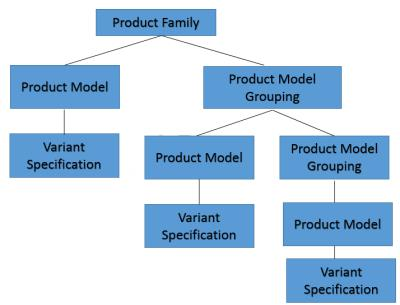

# Product Family Overview

> 来源：PTC Windchill Help Center（R13.1.2.0）  
> 原文：[PTC Help Center](https://support.ptc.com/help/windchill/r13.1.2.0/en/Windchill_Help_Center/prodfamily/ProdFamilyOview.html)  
> 获取日期：2026-11-12

A Product Familyis defined as a grouping of products that are similar but slightly different in order to meet certain market needs. A product is an item that a company sells. A product may have different versions called a variant specifications, such as differing sizes or differing colors.

A product and variant specification can be defined in many ways in Windchill, such as Product container, End Item, Variant Specification. The problem with this is that there is not a single solution that allows a company to use this data to define a Product Family.

A Product Family can be defined as a structure consisting of 4 types objects:

- Product Family is the main object that defines a product family and the root level of the product family structure.

- Product Model Grouping is used to define an organizational breakdown to categorize product models within the product family.

- Product Model the actual product defined within a product family, which can represent a product sold such as an SKU or customer-specific order, or a representative configuration used for planning and validation.

- Variant Specification is a different version of a product, such as a different set of options. For more information, see [Managing Variant Specifications in a Product Family](../10-managing-vari-9babf126/index.md#wwID0ERZ4T "Managing Variant Specifications in a Product Family").

## Product Family Relationships

- A Product Family can be related to a product model and product model grouping.

- A product Model Grouping can be related to a product model and product model grouping.

- A Product Model can be related to a Variant Specification.

## Visibility

Product Families can be created and accessed using the Product Families menu from the Navigator in a Product or Library context.

Product Family Members exist in the context of either a Product or Library, and are created in that context’s default domain (and default folder) for access control purposes.

Product Families can be found in the Product Family Table on a Product or Library information page.

All Product Family objects can appear as search results using advanced search.

## Related Links
