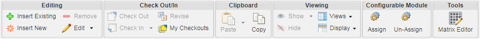

# Product Family Structure Tab

> 来源：PTC Windchill Help Center（R13.1.2.0）  
> 原文：[PTC Help Center](https://support.ptc.com/help/windchill/r13.1.2.0/en/Windchill_Help_Center/prodfamily/PFSBTabAbout.html)  
> 获取日期：2026-11-12

The Product Family **Structure** tab consists of the following areas:

<table border="1">
              <tr>
                <th>
                  
Section

                </th>
                <th>
                  
Description

                </th>
              </tr>
              <tr>
                <td>
                  
Tool bar

                </td>
                <td>
                  
Contains actions for managing a Product Family structure.

For more information, see Product Family Structure Tab Actions.
</td>
              </tr>
              <tr>
                <td>
                  
Product Family structure table

                </td>
                <td>
                  
Displays the hierarchical structure of a Product Family. Use the Viewing actions group in the tool bar to manage the view of the structure. For information about adding members to the Product Family structure, see <a href="../index.md#wwID0EISZT">Creating Product Family Structures</a>.

                </td>
              </tr>
              <tr>
                <td>
                  
Selected objects tabs pane

                </td>
                <td>
                  
Displays the Attributes tab of the object selected in the Product Family structure table. If 2-Pane Display is selected, then additional tabs for the object are layered after the Attributes tab.

                </td>
              </tr>
              <tr>
                <td rowspan="3">
                  
Additional tabs pane

                </td>
                <td>
                  
When 3-Pane Display is selected, this pane displays at the bottom of the page. If the selected object in the Product Family structure table has additional tabs aside from Attributes, then they are displayed in this pane.

                </td>
              </tr>
              <tr>
                <td>
                  
When a variant specification is selected, the Option Filter tab displays. For more information on this tab, see <a href="../../12-product-family-84175e/06-matrix-editor-d-82d251/index.md#wwID0EJ5NU">Matrix Editor Details Pane</a>.

                </td>
              </tr>
              <tr>
                <td>
                  
When a variant baseline is selected, the Baseline Objects tab displays. For more information, see <a href="../../11-variant-baselines/08-baseline-objects-table/index.md#wwID0EXCEU">Baseline Objects Table</a>.

                </td>
              </tr>
            </table>

## Product Family Structure Tab Actions

Actions for managing a Product Family structure are available from the Product Family **Structure** tab **Actions** menu, tool bar, or right-click action menu on a Product Family object. For a description of common Windchill actions, see [Actions Common Among Objects](https://support.ptc.com/help/windchill/r13.1.2.0/en/Windchill_Help_Center/commonactions/CommonActionsRef.html).

The following actions are particularly useful for managing a Product Family structure:

<table border="1">
              <tr>
                <th>
                  
Actions Group

                </th>
                <th>
                  
Icon

                </th>
                <th>
                  
Action Name

                </th>
                <th>
                  
Description

                </th>
              </tr>
              <tr>
                <td rowspan="4">
                  
Editing

                </td>
                <td>

</td>
                <td>
                  
Insert New

                </td>
                <td>
                  
Adds a node to the structure. The Insert New Product Family Member opens to create valid objects for the selected position within the structure.

                  
For more information, see <a href="02-insert-new-pr-d9b5fbb4/index.md#wwID0EJE4T">Insert New Product Family Member</a>.

                </td>
              </tr>
              <tr>
                <td>

</td>
                <td>
                  
Insert Existing

                </td>
                <td>
                  
Opens the Insert Existing window, where you can insert a product model group, product model, or variant specification.

                  
Using this action, you can insert an existing stand-alone variant specification to a product model. As a result, the variant specification becomes an organized variant specification that you can organize within the Product Family.

                  

                    <table>
                      <tr>
                        <td>
                          
 

                        </td>
                        <td>
                          
• A stand-alone variant specification exists outside of a Product Family structure. A variant specification that is created using the Configure action is an example of a stand-alone variant specification.

                          
• To be able to insert an existing stand-alone variant specification to a product model, you must have the “Modify” permission.

                          
• You cannot add a checked out variant specification to a product model.

                          
• A variant specification must belong to only one product model.

                        </td>
                      </tr>
                    </table>
                  

                  
For more information, see <a href="https://support.ptc.com/help/windchill/r13.1.2.0/en/Windchill_Help_Center/prodstructure/PMChildPartAdd.html#wwID0EL6LM">Inserting an Existing Part</a>.

                </td>
              </tr>
              <tr>
                <td>

</td>
                <td>
                  
Remove

                </td>
                <td>
                  
Removes a product model group, product model, or variant specification from the Product Family structure. The parent Product Family member is automatically checked out, and remains checked out after the Remove action is complete. Using this action, you can remove an organized variant specification from a product model. As a result, the variant specification becomes a stand-alone variant specification and can no longer be organized within the Product Family.

                  

                    <table>
                      <tr>
                        <td>
                          
 

                        </td>
                        <td>
                          
• This action does not remove variant baselines. Variant baselines are automatically removed from a Product Family structure when it is no longer associated with a variant specification that is a member of the Product Family.

                          
• You cannot remove a checked out variant specification to a product model.

                        </td>
                      </tr>
                    </table>
                  

                </td>
              </tr>
              <tr>
                <td>

</td>
                <td>
                  
Edit

                </td>
                <td>
                  
Opens the Edit Product Family window, where you can edit attributes (such as name and description) of a Product Family, product model group, or product model.

                  
For more information, see <a href="01-editing-a-pro-5cd55b03/index.md#wwID0EJ53T">Editing a Product Family Object</a>.

                </td>
              </tr>
              <tr>
                <td rowspan="4">
                  
Check Out/In

                </td>
                <td></td>
                <td>
                  
Check Out

                </td>
                <td rowspan="4">
                  
For information on these actions, see <a href="https://support.ptc.com/help/windchill/r13.1.2.0/en/Windchill_Help_Center/prodstructure/PMActionSetCheckOutIn.html#wwID0ENPNM">Check Out/In Action Set - Parts</a>.

                </td>
              </tr>
              <tr>
                <td></td>
                <td>
                  
Check In

                </td>
              </tr>
              <tr>
                <td></td>
                <td>
                  
Revise

                </td>
              </tr>
              <tr>
                <td></td>
                <td>
                  
My Checkouts

                </td>
              </tr>
              <tr>
                <td>
                  
Clipboard

                </td>
                <td></td>
                <td>
                  
Paste

                </td>
                <td>
                  
Opens the Paste as Copy window, where you can specify objects to paste as copies of the Product Family object that you have copied to the clipboard.

                  
For the Managed and Organized variant specifications, you can use this action save the existing variant specifications as new to create new variant specifications with a different type. In the Paste as Copy window, you can specify name and number for the new variant specification and all other attributes of the source variant specification are copied as is. You can create one or more variant specifications from one or more existing source variant specifications.

                  
You can also create new variant specifications outside the Product Family from stand-alone and Organized variant specifications using theSave As action. However, you can use this action only for a single variant specification.

                  
When you use the Paste or Save As action, the stand-alone variant specification remains stand-alone, and the organized variant specification becomes stand-alone after pasting. As a result, the Product Family reference is removed for the new stand-alone variant specification that is created from the organized variant specification. You can create new variant specifications from the existing ones by using any of the following methods:

                  
• Copy one or more managed or organized variant specifications and paste them to a product model.

                  
• Copy one or more stand-alone variant specifications and paste them to a folder.

                  
• Select a stand-alone variant specification and perform the Save As action.

                  

                    <table>
                      <tr>
                        <td>
                          
 

                        </td>
                        <td>
                          
• To create a new variant specification, you must have the appropriate Create permission.

                          
• The target product model where you want to paste the variant specifications to, must support the variant specification type.

                          
• The Type attribute for the new variant specification is read-only if only one valid variant specification type exists.

                          
• The Option Filter and manual selections are copied as is to the new variant specifications.

                        </td>
                      </tr>
                    </table>
                  

                </td>
              </tr>
              <tr>
                <td colspan="4">
                  
When you remove an organized variant specification from a product model, it becomes a stand-alone variant specification.

                  
To add a stand-alone variant specification to a product model, you can use the Insert New action.

                  
The following actions are unavailable for the organized variant specifications:

                  
• Edit Option Filter

                  
• New Variant Baseline

                  
• Assign to Existing Variant Baseline

                </td>
              </tr>
              <tr>
                <td rowspan="4">
                  
Viewing

                </td>
                <td></td>
                <td>
                  
Show

                </td>
                <td>
                  
Displays the information for:

                  
• Show All

                  
• Variant Baseline: If you have added a non-latest revision of a managed variant specification to a variant baseline, then in the Show mode, the system displays that non-latest revision of the managed variant specification for the variant baseline and the latest revision of the managed variant specification under the product model. Whereas in the Hide mode, the system always displays the latest revision of the managed variant specification under the product model. This action to view or hide variant baselines is controlled by the Product Family Structure Related Information preference available in Preference Management &gt; Structure &gt; Related Information. This preference allows you to show or hide variant baselines automatically when the Product Family Structure Browser or Matrix Editor is displayed initially.

                  
• Manage Related Information

                </td>
              </tr>
              <tr>
                <td></td>
                <td>
                  
Hide

                </td>
                <td>
                  
Hides the selected variant baseline in the Product Family structure.

                </td>
              </tr>
              <tr>
                <td></td>
                <td>
                  
Views

                </td>
                <td>
                  
Contains the following options to define or change the display of the Product Family structure:

                  
• Default

                  
• Save Structure View

                  
• Manage Structure Views: This action opens the Customize View List: Product Family Structure Tree window, where you can choose a different view to display the Product Family structure. You can also create a new view using the New View icon in this window.

                </td>
              </tr>
              <tr>
                <td>

</td>
                <td>
                  
Display

                </td>
                <td>
                  
Contains nested actions to select all nodes, refresh the structure, and expand or collapse nodes under the selected Product Family objects.

                </td>
              </tr>
              <tr>
                <td rowspan="2">
                  
Configurable Module

                </td>
                <td>

</td>
                <td>
                  
Assign

                </td>
                <td>
                  
Opens the Assign Configurable Module window, where you can assign a configurable module to a Product Family.

                  
For more details, see <a href="../../09-assigning-a-c-82cd3155/index.md#wwID0ERJ4T">Assigning a Configurable Module</a>.

                </td>
              </tr>
              <tr>
                <td>

</td>
                <td>
                  
Un-Assign

                </td>
                <td>

Removes a configurable module assignment to a Product Family. To do this, select the Product Family or product model in the Structure tab and click  Un-Assign .

</td>
              </tr>
              <tr>
                <td>
                  
Tools

                </td>
                <td>

</td>
                <td>
                  
Matrix Editor

                </td>
                <td>
                  
Opens the Matrix Editor window, where you can view, compare, and define variant specifications in a convenient matrix user interface. Product engineers can quickly view a Product Family structure, its associated configurable module, the variant specifications that have been defined from the configurable module, and manage the choices selected for the variant specifications.

                  
For more information, see <a href="../../12-product-family-84175e/index.md#wwID0EYIGU">Product Family Matrix Editor</a>.

                </td>
              </tr>
              <tr>
                <td>
                  
Find in Structure

                </td>
                <td colspan="3">
                  
Allows you to search for a Product Family object. For more information, see <a href="https://support.ptc.com/help/windchill/r13.1.2.0/en/Windchill_Help_Center/prodstructure/PMFindInStructure.html#wwID0E3JBM">Find in Structure</a>.

                </td>
              </tr>
            </table>

## Shortcut Menu Actions

In addition to the actions available on the **Structure** tab tool bar, the following key actions are also available when you right-click in the Product Family structure:

<table border="1">
              <tr>
                <th>
                  
Action

                </th>
                <th>
                  
Description

                </th>
              </tr>
              <tr>
                <td>
                  
New Configuration Context

                </td>
                <td>
                  
Opens the New Configuration Context window, where you can create a configuration context on a variant specification that you can use to open in a CAD session. Any changes that you make to the variant specification are not automatically reflected within the configuration context. You can use the Update Variant Specification action to update the referenced variant specification to the latest version.

                  
For a configuration context that references a managed variant specification, you can edit the filter information (such as configuration specification, spatial filter, attribute filter, and custom filters) that is not referenced from the variant specification. The option filter is derived from the variant specification; hence you cannot edit it.

                  
This action is unavailable, if you have imported the variant specification using package, and if the top-level part is a supplier part.

                  
For more information, see <a href="https://support.ptc.com/help/windchill/r13.1.2.0/en/Windchill_Help_Center/WorkingWithCADandPartStructures/DICAboutConfigContext.html">Configuration Context Overview</a>.

                </td>
              </tr>
              <tr>
                <td>
                  
Convert to Managed

                </td>
                <td>
                  
Converts an organized variant specification into a managed variant specification. As a result, the organized variant specification becomes a managed variant specification in the Product Family. After the conversion, the variant specification is defined by the configurable product structure inherited by the Product Family.

                  

                    <table>
                      <tr>
                        <td>
                          
 

                        </td>
                        <td>
                          
• A variant specification can belong to only one product model.

                          
• You must have the Modify permission to perform this action.

                          
• You can select more than one organized variant specification for conversion.

                          
• This action is unavailable for stand-alone and managed variant specifications.

                        </td>
                      </tr>
                    </table>
                  

                </td>
              </tr>
              <tr>
                <td>
                  
Edit Option Filter

                </td>
                <td>
                  
Opens the Edit Option Filter window, where you can define or modify the choices for a managed variant specification.

                  
For more information, see <a href="../../10-managing-vari-9babf126/05-filtering-opt-d8d3f1c7/index.md#wwID0ERCAU">Filtering Options for a Managed Variant Specification</a>.

                </td>
              </tr>
              <tr>
                <td>
                  
Assign to New Variant Baseline

                </td>
                <td>
                  
Opens the Assign to New Variant Baseline window where you can create a variant baseline and assign the selected variant specification to that variant baseline. The system automatically populates the selected variant specification in the Select Variant Specifications table in the Assign to New Variant Baseline window.

                  

                    <table>
                      <tr>
                        <td>
                          
 

                        </td>
                        <td>
                          
This action is available only for managed variant specifications that are not a part of any variant baseline.

                        </td>
                      </tr>
                    </table>
                  

                  
For more information, see <a href="../../11-variant-baselines/02-new-variant-bas-257e32/index.md#wwID0E5FBU">New Variant Baseline Window</a>.

                </td>
              </tr>
              <tr>
                <td>
                  
Assign to Existing Variant Baseline

                </td>
                <td>
                  
Opens the Assign to Existing Variant Baseline window, where you can search for an existing variant baseline and assign the selected managed variant specifications to it.

                  

                    <table>
                      <tr>
                        <td>
                          
 

                        </td>
                        <td>
                          
This action is available only for managed variant specifications that are not a part of any variant baseline.

                        </td>
                      </tr>
                    </table>
                  

                </td>
              </tr>
              <tr>
                <td>
                  
Unassign from Variant Baseline

                </td>
                <td>
                  
Allows you to unassign variant specifications from a variant baseline from within the Product Family structure. This action is available only for managed variant specifications.

                </td>
              </tr>
              <tr>
                <td>
                  
Show/Hide Related Information

                </td>
                <td>
                  
Allows you to display or hide the related information for:

                  
• Show My Related Information

                  
• Show All

                  
• Hide All

                  
• Variant Baseline

                  
• Manage Related Information

                  
For more information, see Product Family Structure Tab Actions.

                </td>
              </tr>
              <tr>
                <td>
                  
Open Structure in Creo View

                </td>
                <td>
                  
Displays the dynamic representation of a configurable part structure in the context of a variant specification.

                  
You can view the option filter and ad hoc selection rules for the variant specification that are applied when filtering the configurable part structure to obtain the visual representation.

                  
You can define visual mark-ups for the configurable part structure when you use the Creo View.

                  
For information about launching Creo view, see <a href="https://support.ptc.com/help/windchill/r13.1.2.0/en/Windchill_Help_Center/WVSCreoViewIntegration/WVSCreoViewIntegrationLaunchingCView.html">Launching Creo View from Windchill</a>.

                </td>
              </tr>
              <tr>
                <td>
                  
Request Deliverables

                </td>
                <td>
                  
Creates variant solutions (deliverables) for organized and managed variant specifications. As a result, the variant parts no longer appear in the Requested Deliverables table. They appear in the Completed Deliverables table.

                  

                    <table>
                      <tr>
                        <td>
                          
 

                        </td>
                        <td>
                          
• To generate a variant solution, the variant specification must not be shared to a project. It also must not have any generated deliverables attached, and must not be checked out.

                          
• To perform this action, you must have Read and Modify permissions.

                        </td>
                      </tr>
                    </table>
                  

                </td>
              </tr>
            </table>

## Related Links
