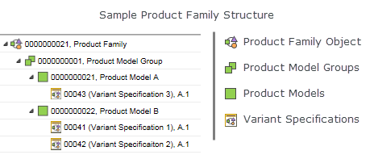

# Creating Product Family Structures

> 来源：PTC Windchill Help Center（R13.1.2.0）  
> 原文：[PTC Help Center](https://support.ptc.com/help/windchill/r13.1.2.0/en/Windchill_Help_Center/prodfamily/ProdFamCreatingProductFamilyStructures.html)  
> 获取日期：2026-11-12

Product Family structures are managed using the table on the Product Family **Structure** tab. A single Product Family object occupies the top node in the hierarchy and additional nodes are added below. A Product Family structure consists of product model groups, product models, and variant specifications. For full descriptions of these Product Family objects, see [Product Family Objects](../02-product-family-objects/index.md#wwID0EFXXT "Product Family Objects"). The following diagram shows an example of a basic Product Family structure.

Several actions, such as **Insert Existing**, **Insert New**, and **Remove** are available from the Product Family structure tab tool bar that are useful when building a Product Family structure. For more information, see [Product Family Structure Tab Actions](01-product-family-e9a2ce/index.md#wwID0E3WZT "Product Family Structure Tab").

Product Family member nodes can be restructured by dragging and dropping them into new configurations. When dragging a Product Family member to a new location the  icon appears if the new location is a valid node. The  icon appears if the drop would create an invalid structure and dropping is disabled. All of the children of the object that is being moved are moved to the new location as well.

To insert a new or existing Product Family member in the structure, you must have modify permission on the parent node where you are inserting the object. Out of the box, only administrators and members of the Product Family Manager role have the necessary permissions to modify Product Family structures.

## Related Links
