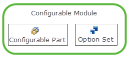

# Assigning a Configurable Module

> 来源：PTC Windchill Help Center（R13.1.2.0）  
> 原文：[PTC Help Center](https://support.ptc.com/help/windchill/r13.1.2.0/en/Windchill_Help_Center/prodfamily/ProdFamilyAssigningAConfigurableModule.html)  
> 获取日期：2026-11-12

A product family structure allows you to organize products that use similar configurable part structures into relational groups in a hierarchy. You can assign a configurable module to product family, which facilitates the reuse of parts and sub-assemblies for planning, design, and management of products. It also enables faster development of new product models because design structures can be reused and iterated upon, minimizing the amount of rework that is needed create new product models.

A configurable module consists of two elements:

- An overloaded configurable part structure

- The option set assigned to the configurable part structure

When a configurable module is assigned to a product family, it is inherited by the product models and variant specifications within the product family. The configurable module that is assigned to a product family member is indicated in the **Configurable Module** field in the object’s attributes table. If the configurable module has been inherited, the name in the configurable module field is appended with (Inherit).

A product family manager can choose to assign a configurable module to a product model that is different than the one assigned to the product family. For example, if a product model’s design requirements are unique from the other product models, then the product family manager may choose to use a configurable part structure that matches the design requirements for that particular product model. A configurable module cannot be directly assigned to a managed variant specification. Instead, it inherits the configurable module that has been assigned to its parent product model. Configurable modules are not assigned to product model groups, which are only organizational nodes for adding group layers to the product family. However, the configurable module assigned to the product family is passed through a product model group to any child product models or variant specifications.

Refer to the [Windchill](../../../01-windchill-opt-7075e8a3/index.md#wwID0ERHQQ "Windchill Options and Variants Capabilities")[ Options and Variants Capabilities](../../../01-windchill-opt-7075e8a3/index.md#wwID0ERHQQ "Windchill Options and Variants Capabilities") help topics for detailed information on working with configurable part structures and option sets.

To assign a configurable module to a product family, use the following procedure.

1. Navigate to the product family’s **Structure** tab.

2. Select the product family node at the top of the product family structure.

3. Click  **Assign** in the **Configurable Module** actions group in the **Structure** tab tool bar.

4. The **Assign Configurable Module** window opens.

1. Specify one or more of the following attributes: type, name, number, and end item classification.

1. Click **Search**.

1. Select a configurable part from the **Search Results** table and click **OK**.

The selected configurable module is assigned to the product family and is listed in the **Attributes** tab for the product family. It is also inherited by any product models and variant specifications in the structure.

To remove a configurable module assignment, select the product family or product model in the product family **Structure** tab and click  **Un-Assign** in the **Configurable Module** actions group in the **Structure** tab tool bar.
