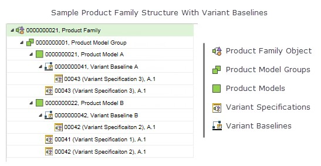

# Variant Specification Information Page

> 来源：PTC Windchill Help Center（R13.1.2.0）  
> 原文：[PTC Help Center](https://support.ptc.com/help/windchill/r13.1.2.0/en/Windchill_Help_Center/prodfamily/ProdFamilyVarSpecInformationPage.html)  
> 获取日期：2026-11-12

The **Variant Specification** information page is a collection point for information related to a variant specification. You can access this page by clicking the information icon  for a managed variant specification listed in the **Variant Specifications** table on the **Variant Baseline** information page.

For more information on the available actions, see [Variant Specification Information Page](../../../../01-windchill-opt-7075e8a3/08-creating-and-a9cfd907/03-variant-speci-1f144356/index.md#wwID0E5FRS "Variant Specification Information Page").

A variant specification is inserted as a child under a product model in a product family structure. If variant baselines are optionally displayed within the product family structure, and a variant specification is associated with a variant baseline, then the variant specification can appear in more than one locations in the structure:

- As a child of its product model parent.

- As a child of any variant baselines that it is added to.

The following sample Product Family structure shows variant specifications displayed twice in the Product Family: once under its parent product model, and once under the variant baseline to which it has been added.

The **Variant Specification** information pane contains the following tabs:

| **Tab** | **Description** |
| --- | --- |
| **Details** | Displays the general attributes of the variant specification information. If the variant specification is associated with a product family, it is linked in this attribute field. Click the link to open the product family structure. |
| **Structure** | Displays the structure of a configurable product. The tab consists of three areas: an action tool bar, a structure pane, and a pane where information is displayed for an object selected in the structure pane. For more information, see [Variant Specification Structure Tab](../03-configuring-m-2e9ec866/01-variant-speci-90c3abcf/index.md#wwID0EHN6T "Variant Specification Structure Tab"). |
| **Changes** | For more information, see [About Change Management](https://support.ptc.com/help/windchill/r13.1.2.0/en/Windchill_Help_Center/changemanagement/ChgMgmtAbout.html#wwID0E6PRU "About Change Management"). |

## Variant Specification Structure Tab Actions

For information on the key actions available under this tab, see [Product Family Structure Tab Actions](../../08-creating-prod-12d7a84f/01-product-family-e9a2ce/index.md#wwID0E3WZT "Product Family Structure Tab") and [Matrix Editor Tool Bar](../../12-product-family-84175e/02-matrix-editor-tool-bar/index.md#wwID0E25GU "Matrix Editor Tool Bar").
