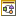

# Managing Variant Specifications in a Product Family

> 来源：PTC Windchill Help Center（R13.1.2.0）  
> 原文：[PTC Help Center](https://support.ptc.com/help/windchill/r13.1.2.0/en/Windchill_Help_Center/prodfamily/ProdFamilyCreatingProductVariants.html)  
> 获取日期：2026-11-12

A Product Family manager can insert variants of a product model that represent a specific configuration of the product called a variant specification. These variant specifications are added as children of product models in the Product Family structure. When creating a variant specification from a Product Family structure, a limited definition of the object can be created in which only meta data (such as name, number, and description) is specified. Later, an option filter can be defined that, when applied to the inherited configurable product structure, represents a variant configuration of the product model.

The system classifies a variant specification object based on its usage.

<table border="1">
              <tr>
                <th>
                  
Icon

                </th>
                <th>
                  
Variant Specification Classification

                </th>
                <th>
                  
Description

                </th>
              </tr>
              <tr>
                <td>

</td>
                <td>
                  
Variant Specification

                </td>
                <td>
                  
Standalone variant that is created using the configure process or programmatically from a spreadsheet. For more information, see <a href="../../../01-windchill-opt-7075e8a3/08-creating-and-a9cfd907/02-creating-vari-da7dff17/index.md#wwID0EPGOS">Creating Variant Structures Using the Configure Process</a> and <a href="https://support.ptc.com/help/windchill/r13.1.2.0/en/Windchill_Help_Center/WCDataLoadGuide/WCDataLoad_OptionsLoadVarSpecSpreadsheet.html">Loading Variant Specifications from a Spreadsheet</a>.

                </td>
              </tr>
              <tr>
                <td>

</td>
                <td>
                  
Managed Variant Specification

                </td>
                <td>
                  
Variant that is created in a product family as a child of a product model by first defining only the object’s metadata (name, number, folder location, and description). After it is created, an option filter can be defined using the Edit Option Filter window. Module variants selections can be manually defined by using the Modules tab. This variant specification works in combination with a variant baseline and its released configuration as supported exclusively in the Product Family Matrix Editor.

                  

                    <table>
                      <tr>
                        <td>
                          
 

                        </td>
                        <td>
                          
When using managed variant specifications, it is a best practice to use them within the Matrix Editor to ensure that the appropriate variant baseline and release configuration are used.

                        </td>
                      </tr>
                    </table>
                  

                </td>
              </tr>
              <tr>
                <td>

</td>
                <td>
                  
Organized Variant Specification

                  

                    <table>
                      <tr>
                        <td>
                          
 

                        </td>
                        <td>
                          
The tooltip for this icon appears as Variant Specification in the application’s user interface.

                        </td>
                      </tr>
                    </table>
                  

                </td>
                <td>
                  
A variant specification that is originally created as a standalone variant (using the configure process or programmatically) and can later be inserted into a product family as a child of a product model. Once added, it becomes individually defined and managed within the product family structure, effectively making it an organized variant specification. This type of variant retains its standalone origin but is structurally tied to the product family for ongoing management and organization.

                  
For more information, see <a href="../../../01-windchill-opt-7075e8a3/08-creating-and-a9cfd907/05-variant-part-6a8db4b0/index.md#wwID0EW6TS">Variant Specification Information Page</a>.

                </td>
              </tr>
            </table>

Because a managed variant specification can be partially defined with only metadata, it can be added to a product family structure as a placeholder for planning purposes. At a later time, as the designs for component parts of the configurable product are created, the variant specification can further define the appropriate choice selections within its option filter definition.
