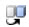

# Replace Variant Specification Window

> 来源：PTC Windchill Help Center（R13.1.2.0）  
> 原文：[PTC Help Center](https://support.ptc.com/help/windchill/r13.1.2.0/en/Windchill_Help_Center/prodfamily/ProdFamilyReplaceProductVariantWindow.html)  
> 获取日期：2026-11-12

Use the **Replace Variant Specification** window to choose a different revision of a variant specification that is associated with a variant baseline. To do this, use the following procedure.

1. Navigate to the variant baseline’s information page and select the **Variant Specifications** tab.

2. In the **Variant Specifications** table, click **Replace this Variant Specification with a different revision** for the variant specification that you want to update.

3. The **Replace Variant Specification** window opens. In the table, select a revision and click **OK**. The revision you selected is now listed in the **Variant Specification** table.
