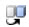

# Variant Specifications Table

> 来源：PTC Windchill Help Center（R13.1.2.0）  
> 原文：[PTC Help Center](https://support.ptc.com/help/windchill/r13.1.2.0/en/Windchill_Help_Center/prodfamily/ProdFamilyProductVariantsTab.html)  
> 获取日期：2026-11-12

The **Variant Specifications** table displays on the **Variant Specifications** tab of a variant baseline’s information page and lists the variant specifications that have been associated with the variant baseline. Multiple variant specifications can be associated with a variant baseline. However, note that one variant specification revision can only be associated with one variant baseline at a time. To manage the variant baselines listed in the table, use the following actions.

| Action | Description |
| --- | --- |
| **Add Variant Specifications**  | Opens the **Find Variant Specifications** window where you can search for variants by name, number, and revision to add them to the table. |
| **Remove Variant Specifications**  | Removes the variant specification’s association with the variant baseline. |
| **Replace this Variant Specification with a different revision**  | Opens the [Replace Variant Specification](01-replace-varia-2074f469/index.md#wwID0EOWDU "Replace Variant Specification Window")[ window](01-replace-varia-2074f469/index.md#wwID0EOWDU "Replace Variant Specification Window"), where you can select a revision of the variant specification. |
