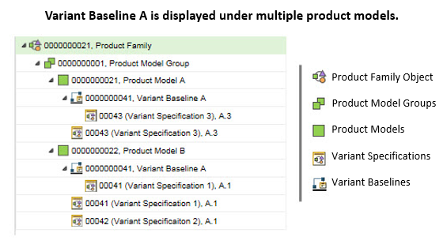

# Variant Baselines

> 来源：PTC Windchill Help Center（R13.1.2.0）  
> 原文：[PTC Help Center](https://support.ptc.com/help/windchill/r13.1.2.0/en/Windchill_Help_Center/prodfamily/ProdFamilyVariantBaselines.html)  
> 获取日期：2026-11-12

A variant baseline is a specialized baseline that captures the revisions of non-configurable parts used to define the configuration for one or more managed variant specifications. Variant baselines are used to manage the development of prototypes and validation of variant specifications.

Variant baselines are accessed from a Product or Library folder, a Product Family structure, and the Product Family Matrix Editor. A variant baseline is organized in a Product Family as a child node of any product model that is a parent to a variant specification managed in the variant baseline. For example, if variant specifications 1 and 3 are being managed in variant baseline A, and the variant specifications are children of different product models, then the variant baseline will appear within the Product Family as a child of both product models. The following sample Product Family structure demonstrates this scenario.

>  **Note:** If a variant baseline is created from the Product Family structure tab, but is not associated with a variant specification, then it does not appear in the Product Family structure. However, it can be accessed from the application context’s folder. When a variant baseline is associated with a variant specification, then it is displayed in the Product Family structure.

Variant baselines are displayed by default in the Product Family structure browser and the Matrix Editor. They can be hidden or displayed using the Show > Variant Baseline action. Administrators can set the **Product Family Structure Related Information** preference to specify whether variant baselines are initially displayed in the Product Family structure browser and the Matrix Editor. For more information on this preference, see [Product Family Management Preferences](../13-product-famil-9fdce8c5/02-product-famil-d963a369/index.md#wwID0EOZOU "Product Family Management Preferences").

The status of baseline objects is used to track the progress of the object as it proceeds through the prototype process. You can observe a part’s status in the **Status** column of the **Baseline Objects** table that is available from the **Baseline Objects** tab in the Product Family **Structure** tab and the variant baseline information page. As a baseline object progresses through the prototype process, you must manually update the status to reflect its progress using the [Edit Baseline Objects](08-baseline-objects-table/03-edit-baseline-o-9db595/index.md#wwID0ERZFU "Edit Baseline Objects Window")[ window](08-baseline-objects-table/03-edit-baseline-o-9db595/index.md#wwID0ERZFU "Edit Baseline Objects Window"). In this window, select any of the following attributes:

| Status | Description |
| --- | --- |
| In Work | Work has begun to prepare a prototype of the part. |
| In Procurement | Planning for the prototype is complete and materials to create the part are being sourced. |
| In Assembly | When a baseline object’s status is changed to In Assembly, its association with the variant baseline becomes locked and it cannot be removed or replaced. This protects the part from being replaced with a revision that is different from the prototype part that is being assembled. The lock icon  displays in the **Status** column in the **Baseline Objects** table. Baseline object gets unlocked if you set the **Status** attribute value to any other value than In Assembly. |

These status attributes can be supplemented or replaced with custom attributes.
